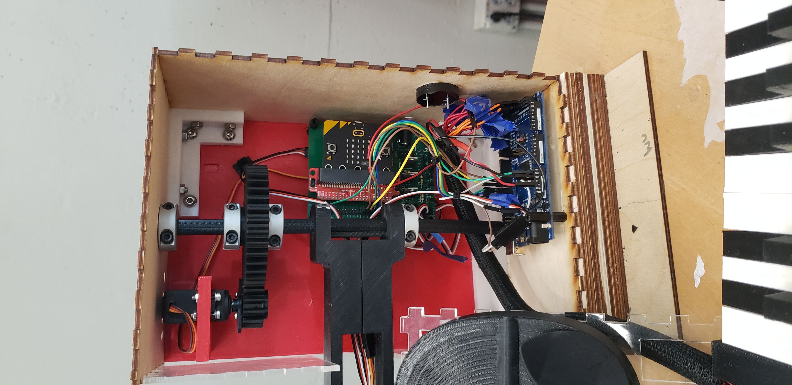
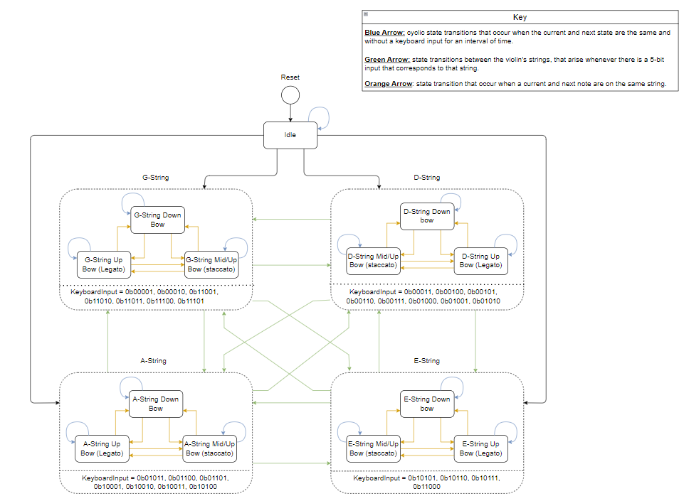

## 음악과 코드를 물리적인 움직임으로 연결하기

RoBACHtic Symphony는 2023년 Georgia Tech ECE 3011 — Design Fundamentals에서 네 명이 함께 개발한 교육용 로봇 키트입니다. 초등학교 5학년 STEAM 활동을 대상으로, 학생이 피아노 형태의 건반에서 음을 고르면 해당 음을 듣고 모형 로봇 팔이 바이올린의 어느 현으로 움직이는지 볼 수 있도록 구상했습니다.

악보의 지시를 눈에 보이는 물리적 동작으로 연결하는 것이 출발점이었습니다. 이를 위해 직접 제작한 건반, 임베디드 제어, 축소 바이올린 모형, 서보 구동 기구와 수업 계획을 결합했습니다. 저는 기계 설계와 제작을 맡아 SolidWorks 모델링부터 부품 제작, 통합 과정에서의 설계 수정까지 진행했습니다.

<figure>

<figcaption>건반, 바이올린 모형, 기어 구동 팔과 레이저 커팅 외함을 하나의 시연 시스템으로 결합한 시제품입니다.</figcaption>
</figure>

## 시스템 구조: 하나의 입력과 두 가지 출력

핵심 상호작용은 건반 입력을 움직임과 소리에 함께 연결하는 것입니다. 제어기는 선택한 음과 옥타브를 해석해 대응하는 현 위치를 정하고, 로봇 팔의 움직임과 micro:bit 스피커의 전자 음 출력을 연결합니다.

| 하위 시스템 | 프로젝트에서의 기능 |
| --- | --- |
| 피아노 형태의 건반 | 12개 음 건반과 옥타브 선택 등의 추가 입력을 제공합니다. |
| 입력·제어 전자 회로 | 건반과 제어기를 연결하고 입력을 음과 동작 상태로 변환합니다. |
| 로봇 팔 | 현 위치를 선택하고 기본적인 활 움직임을 보여 줍니다. |
| 전자 음 출력 | 시연된 시제품에서는 micro:bit 스피커로 음의 주파수를 출력합니다. |
| 기계 프레임 | 바이올린 모형, 팔, 건반과 회로를 지지하며 동작 범위와 배선 공간을 확보합니다. |

건반 + 옥타브<b aria-hidden="true">→</b>음·현 상태<b aria-hidden="true">→</b>팔 위치 + 전자 음

사람 팔의 동작은 교육용 모형으로 제작하고 이해할 수 있는 기구로 단순화했습니다. 이 선택에 따라 부품 형상, 관절 운동, 음과 현 위치 사이의 대응 관계가 중요한 설계 문제가 되었습니다.

## 기계 설계와 제작

기구에는 세 가지 주요 구동 기능이 있습니다. 어깨 구동부는 현 사이에서 팔의 위치를 선택하고, 팔꿈치 구동부는 활과 바이올린 사이의 관계를 조절합니다. 활 구동부는 기본적인 상·하행 운동을 만듭니다. 기어와 지지 프레임이 이 움직임을 모형 악기에 연결합니다.

저는 기계 부품과 SolidWorks 모델의 설계·수정, 부품 제작, 목재 패널의 레이저 커팅, 시험 및 하위 시스템 통합에서 나온 피드백의 반영을 담당했습니다. 팔과 활, 기어와 축, 건반과 건반 외함, 메인 외함을 함께 다뤘습니다. 원본 프로젝트에는 이 조립체의 CAD, 출력용 부품과 레이저 커팅 패널 형상이 남아 있습니다.

중요한 수정 대상 중 하나는 팔이 움직이며 차지하는 공간이었습니다. 초기에는 간단한 모형과 레이저 커팅한 아크릴·목재 부품으로 필요한 움직임을 분리해 살펴봤습니다. 이 과정에서 활 구동 팔이 전체 운동 범위에서 외함과 간섭하지 않도록 공간을 확보해야 한다는 점을 확인했습니다. 정지 상태에서 들어맞는 부품도 움직일 때는 충돌할 수 있어, 외함 치수와 팔의 형상을 함께 조정해야 했습니다.

건반도 기계·전자 설계가 맞물리는 부분이었습니다. 출력한 건반과 버튼 연장부는 아래쪽 스위치의 위치와 맞아야 했고, 외함은 반복적인 건반 움직임을 지지해야 했습니다. 메인 박스 안에서는 제어 보드, 고정부, 기어와 배선이 함께 들어가도록 부품 위치를 정했습니다.

<figure>

<figcaption>CAD와 실제 조립체를 비교한 그림으로 주요 구동 기능, 활, 건반과 회로 외함의 위치를 보여 줍니다.</figcaption>
</figure>

<figure>

<figcaption>기계적 간격, 고정 위치와 전자 회로 통합이 서로 밀접하게 연결된 내부 배치입니다.</figcaption>
</figure>

## 건반 입력과 상태 기반 제어

선택한 음과 옥타브가 제어기의 음악적 상태를 결정합니다. 이 상태는 소리를 내기 위한 음높이와 팔이 이동할 목표 위치를 함께 정해야 합니다. 서로 다른 음이 같은 바이올린 현에 대응할 수도 있으므로, 음이 바뀔 때마다 현 위치가 달라지는 것은 아닙니다.

설계에서는 입력 처리, 상태 전이, 오디오와 팔의 움직임을 나눠 다뤘습니다. 상태도는 대기 상태와 네 개 현의 상태군을 중심으로 구성하고, 건반 입력에 따라 현 사이를 전환하도록 정리했습니다. 각 현의 상태군 안에서는 활 방향과 아티큘레이션을 달리하는 동작도 구상했습니다.

<figure>

<figcaption>건반 입력을 현과 활의 상태로 연결한 설계 단계의 상태도입니다. staccato·legato 분기는 계획한 동작이며, 해당 제어는 최종 시연에서 완성되지 않았습니다.</figcaption>
</figure>

구현은 작은 인터페이스 시험부터 진행했습니다. 풀업 회로의 버튼 프로그램으로 micro:bit에서 눌림·해제 논리를 확인했고, Arduino Mega 건반 시험에서는 개별 스위치를 읽어 선택한 음을 4비트 값으로 인코딩했습니다. micro:bit 개발 코드에는 디지털 입력으로 음 식별자를 복원하고, 어깨·팔꿈치 위치를 작은 단계로 바꿔 설정한 현 위치로 이동시키는 루틴이 포함되어 있습니다.

이 개발 프로그램들은 하위 시스템을 결합하기 전에 인터페이스를 어떻게 시험했는지 보여 줍니다. 중간 단계와 시험용 동작도 포함되어 있으므로, 최종 시연의 범위는 아래에서 따로 설명합니다. 건반은 음악적 입력 인터페이스로 사용했으며, 범용 MIDI 프로토콜 구현이 확인된 것은 아닙니다.

## 전자 회로와 하위 시스템 통합

전자 회로는 건반 PCB와 메인 제어 보드로 나눴습니다. 건반 설계에는 음과 제어 입력용 스위치를 배치했고, 메인 보드는 micro:bit, 서보, 표시부와 보조 회로의 연결을 담당했습니다. 설계 범위에는 GPIO 확장, IMU, 전원 조절과 외부 앰프·스피커 경로도 포함되었습니다.

통합은 완성된 보드를 연결하는 작업에 그치지 않았습니다. 팀은 먼저 건반과 메인 회로를 브레드보드로 구성하고, PCB의 전기적 규칙 검사와 납땜 이후의 멀티미터 연결 검사를 진행했습니다. micro:bit와 Arduino Mega의 시리얼 출력을 보며 문제가 입력 읽기, 상태 선택, 출력 동작 중 어디에 있는지 구분했습니다.

기계적 시험도 구체적으로 진행했습니다. 출력 부품과 레이저 커팅 부품이 전자 부품에 맞는지 확인하고, 프레임 고정 전에 육각 렌치를 임시 핀처럼 사용해 관통 구멍의 정렬을 점검했습니다. 서보 위치를 조금씩 바꾸는 명령과 시간 간격을 조정하며 의도한 현 위치에 도달하도록 움직임을 다듬었습니다.

## 최종 시연과 보고된 관찰 결과

최종 발표에서는 12개 건반을 두 옥타브 범위에서 시험했습니다. 각 건반은 구분되는 전자 음을 출력했고, 옥타브 버튼은 사용할 수 있는 음역을 바꿨으며, 팔은 선택한 음에 대응하는 현 위치로 움직였습니다. 기본적인 상·하행 활 운동과 건반 PCB·메인 외함 내부 회로의 연결도 시연했습니다.

최종 보고서는 실제 시제품에 대해 다음 관찰값을 기록합니다.

| 항목 | 보고된 관찰값 |
| --- | --- |
| 시제품 무게 | 6 kg |
| 전원이 켜진 구성의 크기 | 45 × 51 × 38 cm |
| 현 사이의 전환 시간 | 3–7초; 설계 목표는 0.5초 미만 |

전환 시간은 중요한 제약을 보여 줍니다. 현을 바꾸는 동작 자체는 보여 줄 수 있었지만, 실제 움직임은 처음 목표한 응답 속도보다 상당히 느렸습니다. 위 값은 팀이 [최종 설계 문서](https://github.com/BellLabsEra/RoBACHtic-Symphony/blob/main/ECE3011%20Team%20C2%20Final%20Document%20Package.pdf)에 기록한 시제품 관찰값입니다.

일부 기능은 부분 구현에 머물렀습니다. staccato·legato 제어는 미완성이었고, 보고된 통합 결과에서는 현 표시 LED 네 개 중 두 개만 안정적으로 동작했습니다. 외부 class-D 앰프·스피커 경로와 의도한 IMU 피드백도 완성되지 않았으며, 건반을 누르는 시간에 따라 소리의 길이를 맞추는 요구도 충족하지 못했습니다. 시연된 시스템은 micro:bit의 전자 음과 팔의 물리적 움직임을 함께 사용했습니다.

## 수업 계획과 제안한 활동 흐름

팀은 설계 문서, BOM과 프로젝트 노트북 외에 수업 계획도 작성했습니다. Georgia의 초등학교 5학년 Music·Computer Science Standards of Excellence를 대상으로 디지털 소리, 순서, 악보와 로봇의 움직임을 연결했습니다.

제안한 수업 순서는 다음과 같습니다.

1. **바이올린과 현 소개:** 개방현의 음과 활 움직임을 익숙한 기악 음악에 연결합니다.
2. **기초 음악 이론:** 옥타브와 활 방향·아티큘레이션 기호를 소개합니다.
3. **디지털 소리 설명:** 아날로그·디지털 표현을 비교하고 키트를 간단한 전자 음 발생 장치로 이해합니다.
4. **조립과 구성 요소 확인:** 건반, 제어기와 움직이는 부품을 각각의 기능에 연결합니다.
5. **연습과 디버깅:** “Twinkle, Twinkle, Little Star” 같은 간단한 선율로 선택한 음과 모형의 동작을 연결합니다.
6. **작곡과 상호 평가:** 서로 다른 음 세 개 이상과 활 기호 다섯 번 이상을 사용해 10–20개 음으로 된 짧은 선율을 만들고 동료와 의견을 주고받습니다.

수업 계획은 기계의 제약 자체도 설계 활동으로 다뤘습니다. 학생이 전환 시간과 한 번에 한 현을 다루는 동작에 맞춰 곡을 바꾸거나, 전통 악기와 함께 연주하거나, 여러 장치를 사용하는 방법을 생각하도록 제안했습니다. 이는 계획한 교실 활동입니다. 프로젝트 결과물은 시제품과 교육 자료이며, 실제 수업의 학습 효과를 측정한 것은 아닙니다.

## 공학적으로 남은 점

음악적 상호작용은 움직이는 기구의 실제 제약과 연결되었습니다. 부품 간 간격, 고정 형상과 팔을 다시 배치하는 데 걸리는 시간이 인터페이스가 보여 줄 수 있는 동작에 직접 영향을 줬습니다. 작은 버튼·시리얼 시험은 하위 시스템 통합을 돕고, 최종 발표는 동작하는 음·현 연결과 설계 단계에서 구상한 더 넓은 기능을 구분하는 계기가 되었습니다.

이 과정에서 제가 맡은 부분은 개념을 SolidWorks 부품으로 옮기고, 조립체를 제작하고, 전자·제어 하위 시스템을 결합하며 기계를 수정하는 일이었습니다. 팀은 이를 통해 설계·제작·시험 기록과 수업 계획을 갖춘 교육용 시연 장치를 완성했습니다.
