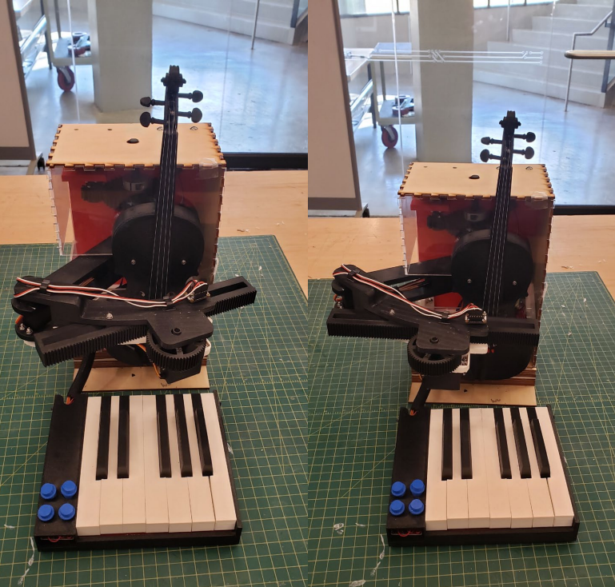
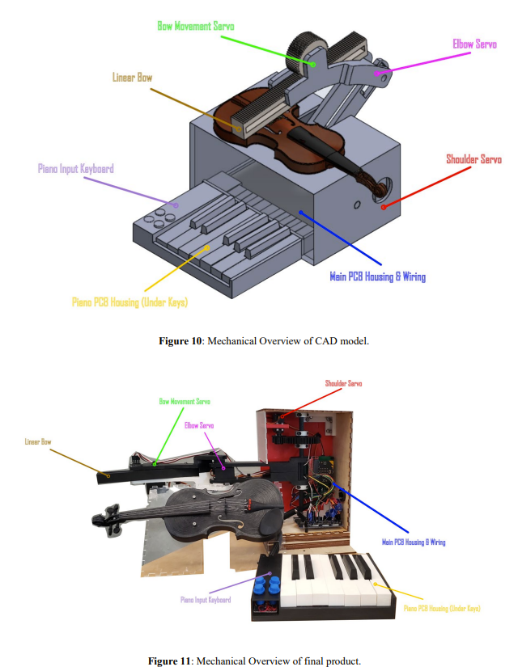

## 음악과 코드를 물리적으로 연결하기

RoBACHtic Symphony는 2023년 Georgia Institute of Technology ECE 3011 — Design Fundamentals 수업에서 4인 팀으로 개발한 프로젝트입니다. 초등학교 5학년 STEAM 활동을 위한 교육용 키트를 구상하고, 음표와 바이올린 활의 움직임 사이의 관계를 물리적 모형으로 보여주고자 했습니다.

팀은 피아노형 건반, BBC micro:bit, 서보 구동 장치, 축소 바이올린 모형을 결합했습니다. 저는 SolidWorks 모델부터 조립된 하드웨어까지 기계 설계와 제작을 주도했습니다.

<figure>

<figcaption>완성된 시제품의 정면 사진 두 장입니다. 피아노형 건반, 바이올린 모형, 기어식 활 구동 장치, 레이저 커팅 외함을 볼 수 있습니다.</figcaption>
</figure>

## 건반 입력에서 활의 움직임까지

건반은 제어기에 음표 입력을 전달하고, 제어기는 바이올린 현에 대한 로봇 팔의 위치와 micro:bit 내장 스피커의 전자음 출력을 함께 제어합니다. 옥타브 버튼으로 연주할 수 있는 음역을 바꿉니다.

최종 시연에서는 두 옥타브 음역에서 12개 건반을 모두 작동시켰으며, 선택한 음에 대응하는 현 위치로 로봇 팔이 이동하는 모습을 보여주었습니다. 기본적인 올림활·내림활 동작도 시연했습니다. 소리는 micro:bit 스피커에서 출력했으며, 실제 바이올린의 어쿠스틱 연주 성능을 입증한 것은 아닙니다.

## 기계 설계와 제작

저는 SolidWorks 모델을 작성·수정하고, 기계 부품과 레이저 커팅 목재 부품을 제작했습니다. 조립체는 어깨·팔꿈치 구동 장치, 서보로 구동하는 직선형 활, 건반과 주 전자회로를 수용하는 하우징으로 구성했습니다.

각 하위 시스템을 통합하는 과정에서 부품의 맞춤과 움직임을 반복해서 확인했습니다. 팀은 3D 프린팅·레이저 커팅 부품이 전기 부품과 맞는지 확인하고, 조립 전 프레임의 장착 구멍 정렬을 점검했습니다. 저는 시험과 통합 과정에서 받은 피드백을 기계 설계에 반영했습니다.

<figure>

<figcaption>SolidWorks 설계와 실물 제작의 비교입니다. 세 구동 장치, 직선형 활, 건반, 전자회로 하우징의 위치를 표시했습니다.</figcaption>
</figure>

## 교육용 키트와 수업 계획

팀은 시제품과 함께 설계 문서, 부품 명세서, 수업 계획, 프로젝트 노트를 작성했습니다. 수업 계획은 조지아주의 초등학교 5학년 음악·컴퓨터과학 교육 기준인 Georgia Standards of Excellence에 맞춰, 음표와 활의 위치를 프로그램으로 제어하는 물리적 동작에 연결하도록 구상했습니다.

계획한 활동은 악보 읽기와 디지털 소리에 대한 토론에서 시작해 키트 조립, 연습, 동료 평가를 위한 짧은 선율 작곡으로 이어집니다. 이는 계획된 수업 활동으로, 프로젝트에서 학습 효과를 평가하지는 않았습니다.

[최종 문서 모음](https://github.com/BellLabsEra/RoBACHtic-Symphony/blob/main/ECE3011%20Team%20C2%20Final%20Document%20Package.pdf)에는 설계 문서, 수업 계획, 부품 명세서가 포함되어 있습니다.

## 시연 범위

완성된 시제품은 건반에 따른 현 위치 이동, 기본 활 동작, 옥타브 선택이 가능한 전자음 출력을 보여주었습니다. 스타카토·레가토 제어, 현 표시 LED의 완전한 작동, 외부 오디오 증폭은 완성하지 못했습니다. 결과물은 수업 계획을 갖춘 작동 가능한 교육용 시연 장치입니다.
