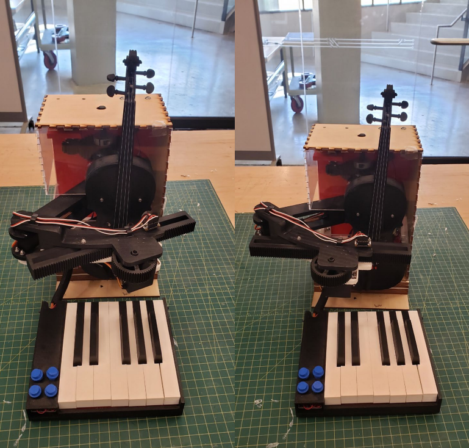
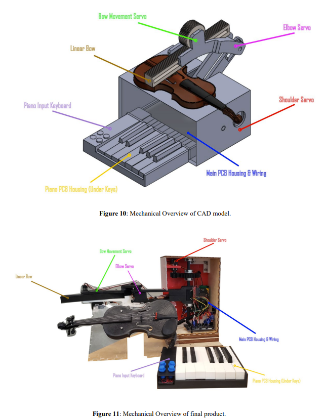

## A physical connection between music and code

RoBACHtic Symphony was developed by a four-person team for Georgia Tech's ECE 3011 Junior Design course. The project explored an educational kit for fifth-grade STEAM activities, connecting keyboard input to violin-string selection, bow movement, and electronically generated note tones.

The team combined a piano-style keyboard, microcontroller control, servo-driven mechanisms, and a scaled violin model. The final demonstration used the micro:bit's speaker for note output while the robotic arm moved between string positions.

*Front views of the team's completed prototype.*

## Mechanical design and fabrication

I led the mechanical portion of the project: creating and updating SolidWorks models, building mechanical components, fabricating laser-cut wooden parts, and revising the design through motion checks and subsystem integration testing.

*The mechanical layout, from CAD to the assembled demonstrator.*

## An educational kit and lesson plan

The four-person team brought together electrical, computer, and mechanical design work. Alongside the prototype, we prepared a design document, bill of materials, lesson plan, and project notebook. The lesson plan was designed around Georgia's fifth-grade Music and Computer Science Standards of Excellence, connecting musical notes and bow positions to programmable physical actions.

The [final document package](https://github.com/BellLabsEra/RoBACHtic-Symphony/blob/main/ECE3011%20Team%20C2%20Final%20Document%20Package.pdf) includes the design document, lesson plan, and bill of materials.

## Demonstrated scope

The final report documents keyboard-controlled string positioning, basic up/down bow movement, and electronic note output with octave selection. Advanced articulation controls, full LED indication, and external audio amplification remained incomplete. The result was an educational demonstrator; acoustic violin performance and classroom learning gains were not established by the available evidence.
