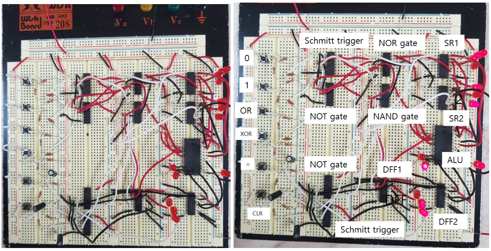
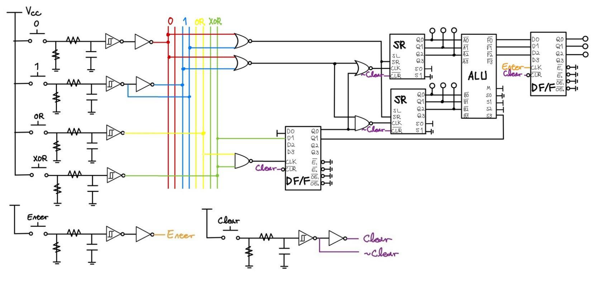
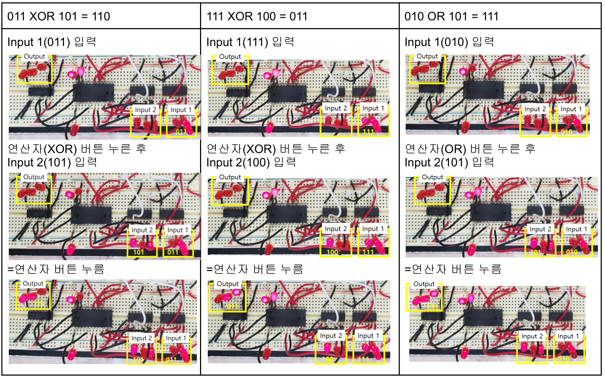

## 회로 모델에서 실제 시스템까지

KAIST의 전자회로 실험 수업에서 회로 계측, 브레드보드 설계, 마이크로컨트롤러 프로그래밍과 통신 시뮬레이션을 함께 다뤘습니다. 조별 과제를 통해 이론 모델을 배선·측정·디버깅으로 연결했으며, Lab 4–5의 계산기는 이 과정에서 직접 회로를 설계하고 제작한 주요 과제였습니다.

## Lab 4–5: 논리 설계에서 동작하는 계산기까지

Lab 4–5에서는 최대 3비트의 두 이진수에 OR·XOR 연산을 수행하는 계산기를 제작했습니다. 실험 조원과 함께 회로를 설계하고 브레드보드로 조립했습니다.

ALU, 시프트 레지스터, D 플립플롭 레지스터와 논리 게이트를 연결해 데이터 저장과 입력 순서를 하드웨어로 구현했습니다. 논리 설계를 실제 버튼 입력과 배선, 눈으로 확인할 수 있는 출력까지 이어 본 과제입니다.

<figure>

<figcaption>실제로 조립한 계산기와 구성 요소를 표시한 사진. 왼쪽의 입력 스위치에서 오른쪽의 저장·연산·출력 회로로 신호가 이어집니다.</figcaption>
</figure>

### 입력을 순서대로 기억하는 회로

사용자는 `0`·`1` 버튼으로 첫 번째 피연산자를 넣고, `OR` 또는 `XOR`를 선택한 다음 두 번째 피연산자를 입력합니다. 마지막에 `=`를 누르면 결과가 LED에 표시되고, `CLR`를 누르면 저장 상태가 초기화됩니다. 한 자리나 두 자리 수는 앞에 0을 채우지 않고 입력할 수 있도록 설계했습니다.

두 개의 74194 시프트 레지스터가 각각 피연산자를 저장합니다. 첫 번째 74173 레지스터는 연산자가 선택됐는지와 어떤 연산자인지를 기억해 입력이 들어갈 레지스터와 ALU의 기능을 결정합니다. 74LS181 ALU가 두 값을 연산하고, 두 번째 74173이 `=` 입력 시 결과를 저장해 표시합니다. 조합논리의 계산과 순차논리의 상태 기억을 하나의 동작 흐름으로 연결한 부분입니다.

<figure>

<figcaption>입력 처리, 피연산자 저장, 연산 선택과 결과 표시를 연결한 설계 회로도. 연산 선택 상태를 이용해 두 레지스터의 입력을 구분했습니다.</figcaption>
</figure>

### 스위치 한 번을 논리 입력 한 번으로

실제 스위치에는 접점 바운싱과 불안정한 전압 전이가 있어, 버튼을 회로에 직접 연결하는 것만으로는 의도한 입력을 만들기 어려웠습니다. RC 저역통과 필터와 7414 Schmitt trigger로 입력을 정리하고, 신호가 반전되는 부분까지 고려해 제어 논리를 구성했습니다.

초기 배선에서는 스위치와 GND 사이의 저항이 빠져 입력이 제대로 동작하지 않았습니다. 데이터시트를 다시 확인해 연결을 수정했고, 여러 입력선이 한곳에 몰리는 문제는 입력 처리 회로를 나눠 배치하며 해결했습니다. 논리식이 맞는지 확인하는 일에 더해, 배선·전원·실제 소자 출력을 차례로 점검하는 과정이 필요했습니다.

### OR·XOR와 초기화 시험

보고서에는 `011 XOR 101 = 110`, `111 XOR 100 = 011`, `010 OR 101 = 111`의 입력·출력 과정이 사진으로 남아 있습니다. 피연산자 입력, 연산자 선택, 두 번째 입력, 결과 표시를 단계별 LED 상태로 확인했고, 계산 도중에도 `CLR`로 저장 상태가 초기화되는지 점검했습니다.

<figure>

<figcaption>열마다 하나의 시험 사례를, 위에서 아래로 입력과 결과 표시 과정을 보여 줍니다. 출력 LED는 각각 110, 011, 111을 나타냅니다.</figcaption>
</figure>

계산기는 수업의 요구 기능을 수행했지만, 반드시 정해진 순서로 입력해야 했고 첫 번째 피연산자를 바꾸려면 전체 초기화가 필요했습니다. 동작이 불안정한 소자를 교체한 기록도 있습니다. 소자 수를 줄이는 설계와 직관적인 제어·배선, 디버깅 편의 사이의 절충을 경험한 제작 과제였습니다.

## 함께 다룬 실험

### 디지털 오디오 통신, Lab 7–8

MATLAB으로 PCM 양자화·부호화, QPSK 변조, AWGN 채널, 복조로 이어지는 오디오 전송 체인을 시뮬레이션했습니다. 이후 부호율 1/2의 길쌈 부호와 4상태 Viterbi 복호기를 추가하고, 부호화 유무에 따른 복원 오디오와 비트 오류 특성을 비교했습니다.

복호기는 수업의 특정 트렐리스에 맞춰 구현했습니다. 물리 회로를 제작하는 실험과 함께 통신 시스템을 시뮬레이션으로 구성하고 분석한 과제입니다.

### 임베디드 타이밍과 아날로그 오디오

ATmega128A 스톱워치를 C로 구현했습니다. 타이머·외부 인터럽트로 LCD를 갱신하고 시작·정지·초기화 입력을 처리하며, 프로그램의 시간 제어와 실제 버튼 동작을 연결했습니다.

아날로그 오디오 실험에서는 증폭 및 고역·저역 통과 필터를 다뤘습니다. 측정 응답을 이론 예측과 비교하고 오디오 신호로 동작을 확인하며, 실제 회로의 잡음과 부품·배선 문제를 점검했습니다.

### 계측과 소자

RC 과도응답, RLC 응답, 임피던스·위상 측정, 다이오드와 LED–포토트랜지스터 회로를 실험했습니다. 이 과정에서 익힌 계측과 소자 점검 방법을 다른 제작 과제에도 활용했습니다.
