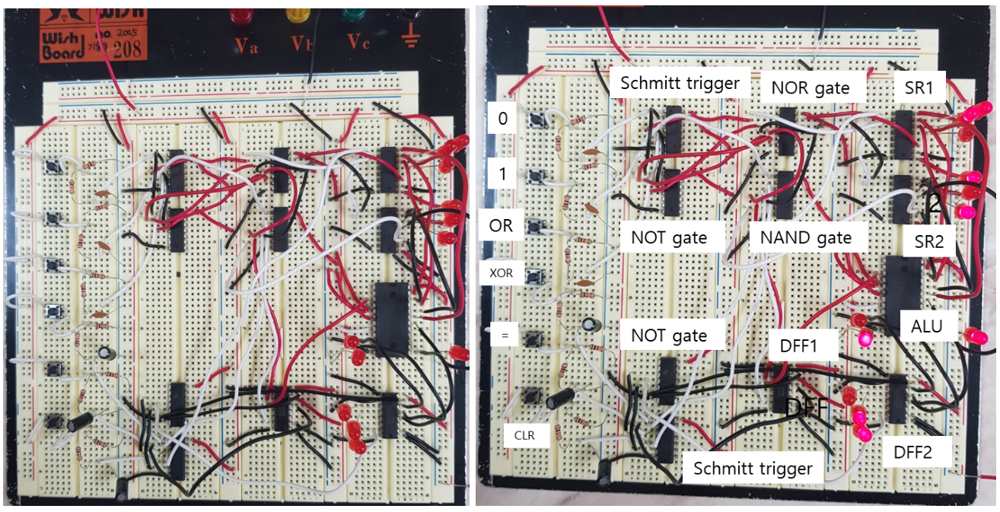
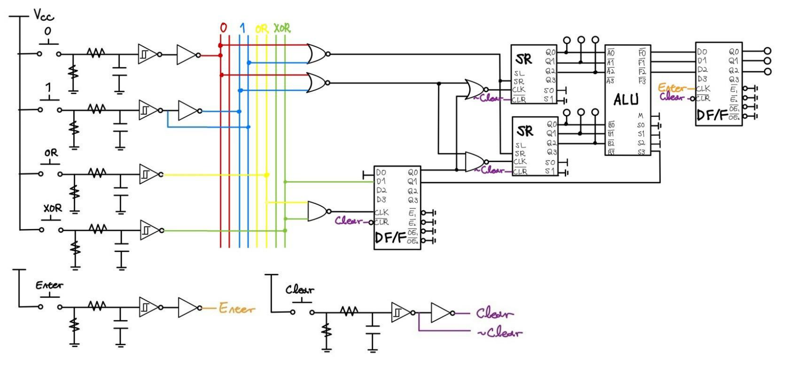
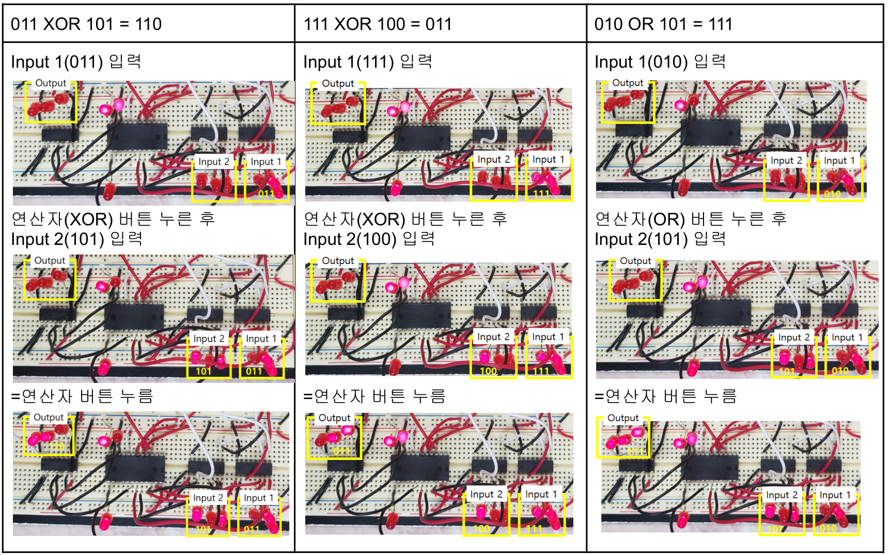

## From circuit models to physical systems

This KAIST laboratory course combined circuit measurement, breadboard design, microcontroller programming, and communication-system simulation. Group assignments connected analytical models with wiring, measurements, and debugging. The calculator in Labs 4–5 was a substantial hardware design exercise within that broader sequence.

## Labs 4–5: From logic design to a working calculator

For Labs 4–5, our laboratory group designed and assembled a breadboard calculator for OR and XOR operations on two binary operands of up to three bits.

An ALU, shift registers, D flip-flop registers, and logic gates implemented the storage and input sequence directly in hardware. The work connected a logic design to physical inputs, wiring, and a visible result.

<figure>

<figcaption>The assembled calculator and its labeled components. Signals pass from the input switches on the left to the storage, logic, and output circuits on the right.</figcaption>
</figure>

### Remembering the input sequence

The user enters the first operand with the `0` and `1` buttons, selects `OR` or `XOR`, and enters the second operand. Pressing `=` displays the result on LEDs; `CLR` resets the stored state. One- and two-bit operands can be entered without padding them with leading zeros.

Two 74194 shift registers store the operands. The first 74173 register stores whether an operator has been selected and which operation it represents, controlling the operand input path and ALU function. The 74LS181 performs the operation, and a second 74173 captures the result when `=` is pressed. This connected combinational logic with sequential state storage in a complete user interaction.

<figure>

<figcaption>The calculator schematic links input conditioning, operand storage, operation selection, and result display. Stored operator state determines which register receives the input.</figcaption>
</figure>

### Turning a button press into a logic input

Physical switches introduce contact bounce and unstable transitions. RC low-pass filters and 7414 Schmitt triggers conditioned the inputs, with signal inversions accounted for in the control logic.

An early wiring error omitted a resistor between a switch and ground, preventing correct input behavior. Revisiting the datasheet helped resolve the connection. Dividing the input-conditioning circuitry also reduced wire congestion. Debugging required checking wiring, supply connections, and actual component outputs alongside the logic design.

### Testing OR, XOR, and reset

The report records the input and output sequences for `011 XOR 101 = 110`, `111 XOR 100 = 011`, and `010 OR 101 = 111`. LED states showed the operands and final result at each stage. The group also checked that `CLR` reset stored state during the calculation sequence.

<figure>

<figcaption>Each column follows one test from input entry to result display. The final output LEDs represent 110, 011, and 111, respectively.</figcaption>
</figure>

The calculator met the course's required functions, with practical limitations: inputs had to follow the prescribed sequence, changing the first operand required a full reset, and unreliable components needed replacement. The exercise exposed tradeoffs between minimizing components, keeping control logic understandable, and making wiring and debugging manageable.

## Further laboratory work

### Digital audio communication, Labs 7–8

The MATLAB assignments implemented an audio transmission chain with PCM quantization and coding, QPSK modulation, a simulated AWGN channel, and demodulation. The later assignment added rate-1/2 convolutional coding and a four-state Viterbi decoder, comparing reconstructed audio and bit-error behavior with and without coding.

The decoder followed the course's specific trellis. These assignments developed communication-system simulation alongside the physical circuit exercises.

### Embedded timing and analog audio

The embedded assignment implemented an ATmega128A stopwatch in C. Timer and external interrupts updated an LCD and handled start, stop, and reset inputs, bringing software timing and physical-button behavior together.

Analog audio experiments covered amplification and high-pass/low-pass filters. Measured responses were compared with theoretical predictions, followed by tests with audio signals and practical circuit debugging.

### Instrumentation and devices

Supporting experiments covered RC transients, RLC response, impedance and phase measurement, and diode/LED–phototransistor circuits. These exercises provided the measurement and component-testing background used throughout the course.
