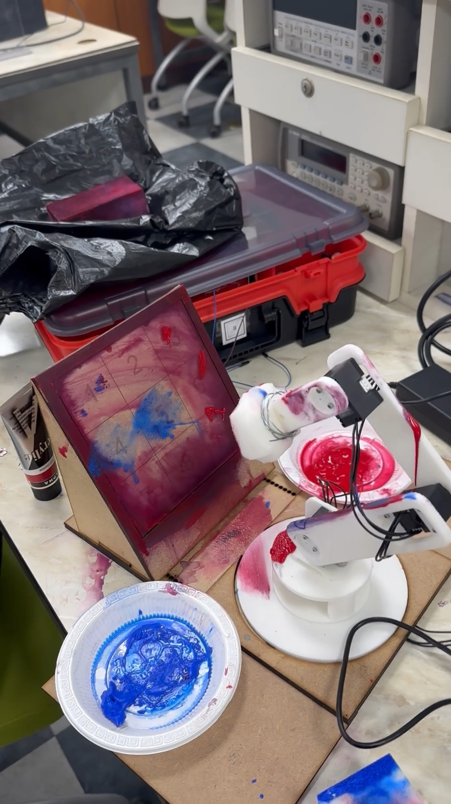
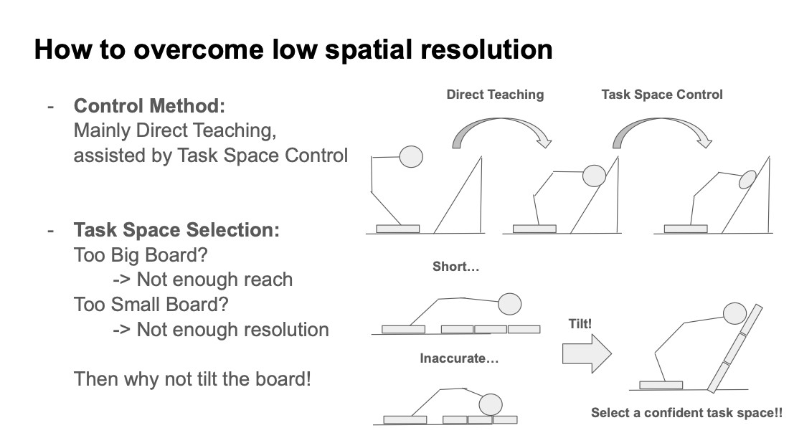
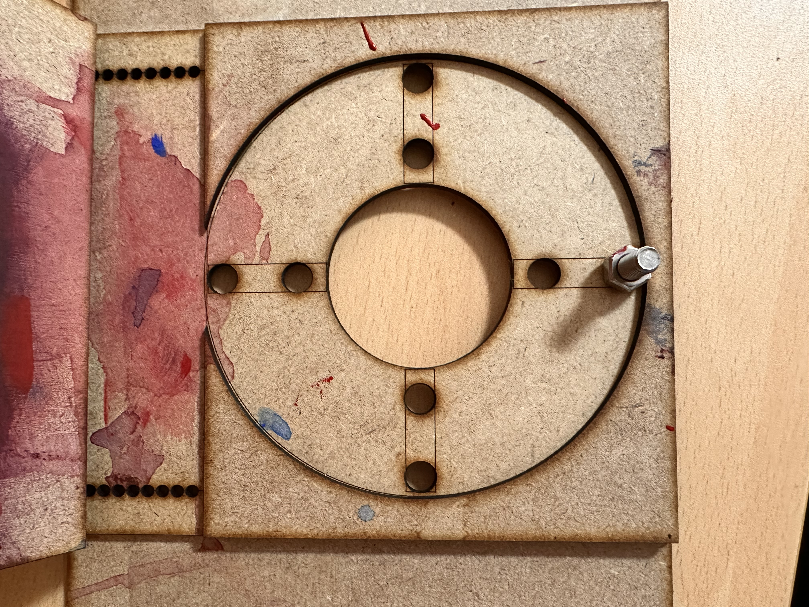

## 보드 게임에 물리적인 출력을 더하기

이 프로젝트의 과제는 게임에서 선택한 한 수를 실제 장치의 반복 가능한 동작으로 바꾸는 것입니다. 사람이 터미널에서 칸을 선택하면 컴퓨터가 대응하는 수를 고르고, 4자유도 로봇 팔이 두 플레이어의 수를 실제 3×3 보드에 표시합니다. 빨강과 파랑 물감 스테이션을 구분해 사용하며, 말단에 물감을 묻힌 뒤 선택한 칸에 접근하고 눌러 표시한 다음 물러납니다.

KAIST EE405의 이 기말 프로젝트는 C++ 애플리케이션, 보정 데이터, 기하학적 로봇 모델, 액추에이터 통신과 보드의 물리적 배치를 함께 다룹니다. 입력은 키보드로 받습니다. 카메라 영상으로 사람의 수를 인식하는 시스템은 아닙니다.

<figure>

<figcaption>최종 시연 영상의 한 장면입니다. 로봇 앞의 기울어진 보드와 플레이어별 물감 스테이션을 함께 볼 수 있습니다.</figcaption>
</figure>

## 보드와 말단 장치를 함께 설계하기

보드의 크기에는 상충 관계가 있습니다. 크게 만들면 칸 사이의 간격을 넓힐 수 있지만 로봇에 더 긴 도달 거리가 필요합니다. 작게 만들면 작업 공간 안에 넣기 쉽지만 제한된 위치 분해능으로 이웃한 칸을 구분하기가 어려워집니다. 프로젝트 발표 자료는 보드를 기울여 로봇이 활용하기 좋은 작업 영역에 과제를 배치하는 접근을 설명합니다.

말단 장치는 X나 원을 궤적으로 그리기보다 둔한 끝으로 도장을 찍도록 구성했습니다. 한 수를 표현하는 동작을 특정 위치에 접근해 접촉하는 작업으로 단순화한 것입니다. 보드 지지대, 층별 플랫폼, 원형 베이스와 말단 장치의 도면이 이 과제 정의를 물리적인 구조로 연결합니다. 주요 자세는 실제 장치에서 직접 교시하고, 필요한 국소 동작에는 작업 공간 조정을 더하는 방식입니다.

<figure>

<figcaption>제어 방법과 물리적 작업 공간의 관계를 설명한 발표 자료입니다. 주요 자세는 직접 교시하고, 필요한 구간에는 작업 공간 동작을 활용합니다.</figcaption>
</figure>

<figure>

<figcaption>제작한 베이스 플레이트의 세부 모습입니다. 위의 조립된 로봇과 구분되는 분리 상태의 기구 부품입니다.</figcaption>
</figure>

## 유효한 한 수를 완전한 동작 순서로 연결하기

소프트웨어는 모든 기능을 하나의 게임 루프에 넣기보다 역할을 나눕니다.

| 계층 | 역할 |
| --- | --- |
| 보드·게임 | 점유한 칸을 저장하고 입력을 검사하며, 컴퓨터의 수와 승패·무승부를 판단 |
| 로봇 플레이어 | 플레이어와 칸 번호를 물감 스테이션·보드 동작으로 변환 |
| 액추에이터 인터페이스 | 관절 위치를 읽고 DYNAMIXEL 속도 명령을 전송 |
| 기구학 | 관절각에서 말단 위치를 구하고 병진 자코비안을 계산 |
| 경유점 데이터 | 보정한 보드·물감 스테이션의 관절 자세를 게임 규칙과 분리해 저장 |

사람 차례에는 1–9 사이의 번호를 입력받습니다. 이미 차지한 칸, 범위를 벗어난 위치나 잘못된 입력은 거부합니다. 수가 받아들여지면 로봇은 해당 플레이어의 물감 위로 이동하고, 내려가 물감을 묻힌 뒤 다시 올라옵니다. 이어 보드 위로 이동해 선택한 칸에 접근하고, 표시를 찍은 뒤 보드 위로 물러납니다. 컴퓨터 차례에도 같은 동작 순서를 사용합니다.

접근 자세와 표시 자세를 분리하는 것은 물리적인 전환 동작도 애플리케이션 설계에 포함한다는 뜻입니다. 한 판이 끝나면 로봇을 대기 자세로 옮기고, 사용자가 재시작과 종이 교체 여부를 선택하게 합니다. 이 상호작용이 끝난 뒤 다음 게임을 위해 내부 보드 상태를 초기화합니다.

## 작고 명확한 규칙 기반 상대

컴퓨터는 세 단계로 수를 선택합니다. 먼저 빈칸을 하나씩 시험해 즉시 이길 수 있는 수를 찾습니다. 없으면 사람이 다음 차례에 이길 수 있는 위치를 막습니다. 두 경우에 해당하지 않으면 남은 빈칸 중 하나를 무작위로 고릅니다.

가상의 수를 시험한 뒤에는 이를 되돌려 실제 게임 상태가 바뀌지 않게 합니다. 학습한 모델이나 전체 minimax 탐색을 사용하는 상대는 아닙니다. 게임의 판단을 단순하고 명시적으로 유지하면서, 선택한 수를 올바른 물리 동작에 연결하는 통합 문제에 집중한 구성입니다.

## 직접 교시와 좌표 데이터의 구성

경유점 기록 도구는 모터 토크를 해제해 팔을 손으로 배치할 수 있게 합니다. 1–9 키로 현재의 네 관절각을 기록하고 종료 명령으로 저장합니다. 이는 보드 영상에서 추론한 위치가 아니라 실제 장치에서 교시한 관절 공간 목표입니다.

게임이 사용하는 데이터는 세 가지입니다.

| 데이터 | 크기 | 용도 |
| --- | --- | --- |
| 사람의 보드 목표 | 9 × 4 | 아홉 칸 각각에서 사용할 네 관절의 목표 자세 |
| 컴퓨터의 보드 목표 | 9 × 4 | 컴퓨터의 표시 동작에 대응하는 칸별 목표 자세 |
| 물감 스테이션 목표 | 2 × 4 | 플레이어별 물감 스테이션의 목표 자세 |

자세를 기록하는 것과 데이터를 용도별로 분류하는 것은 별개의 단계입니다. 교시 도구는 하나의 경유점 파일을 만들며, 측정값이 어느 플레이어나 물감 스테이션에 속하는지 자동으로 분류하지 않습니다. 파일의 행·열 수가 맞는 것만으로는 보드나 로봇 배치가 바뀐 뒤에도 좌표가 올바르다고 볼 수 없습니다.

## 관절 보간과 자코비안 기반 누르기

메인 게임은 네 DYNAMIXEL 축을 속도 제어 모드로 설정하고 100 Hz의 제어 주기를 요청합니다. 동작 루틴은 측정한 시작 관절각에서 목표까지 지정한 시간에 걸쳐 선형 보간합니다. 보간한 기준 자세와 현재 관절각의 오차를 속도 명령으로 바꾸는 제어식은 다음과 같습니다.

$$
\dot{q}_{\mathrm{cmd}} = K_p\bigl(q_{\mathrm{ref}}-q\bigr).
$$

보존된 Advanced 구현은 보드 경유점에 도달한 다음 전역 좌표계의 −z 방향으로 작은 작업 공간 변위를 추가합니다. 기울어진 보드의 법선 방향과는 구분해야 합니다. 현재 자세에서 전역 좌표계의 병진 자코비안을 계산하고, 오른쪽 의사역행렬을 이용해 관절각 증가량을 구합니다.

$$
\Delta q = J(q)^\mathsf{T}\bigl(J(q)J(q)^\mathsf{T}\bigr)^{-1}\Delta x,
\qquad \Delta x = [0,0,-0.01]^\mathsf{T}\ \mathrm{m}.
$$

−10 mm는 코드가 요청하는 변위이며, 실제로 달성한 누름 깊이나 위치 정확도를 측정한 값은 아닙니다. 접촉력을 피드백하는 제어가 아니라 기구학에 기반한 조정입니다. 국소 자코비안과 계산에 사용하는 행렬의 가역성에도 의존하므로, 일반적인 충돌 회피나 특이점 처리까지 포함한 제어기로 해석하지 않습니다.

## 구현의 여러 갈래와 관련 실험

보존된 세 구현은 설계 선택을 이해하는 단서를 제공합니다. Advanced는 게임과 교시된 관절 목표에 추가 누르기 동작을 결합합니다. 별도의 작업 공간 제어 예제는 키보드로 팔을 움직이는 데 집중하며 틱택토 게임 계층을 포함하지 않습니다. 보드의 60도 회전을 보상하려는 실험 구현도 있지만 변수 이름의 불일치가 남아 있어, 이것만으로 검증된 최종 제어기라고 볼 수는 없습니다.

구현은 C++17, Eigen3, CMake, Threads와 DYNAMIXEL SDK를 사용하며, 기본으로 제공된 라이브러리는 ARM Linux 환경을 대상으로 합니다. 앞선 실험에서는 GPIO·그리퍼 스위칭, 모터 측정과 필터링, MATLAB 시각화, PC–BeagleBone 간 TCP/UDP 통신, 직접 교시와 저장한 관절 목표의 재생을 다뤘습니다. 이 과정은 최종 통합을 뒷받침하지만, 각 실험의 동작을 최종 게임의 기능과 혼동하지 않아야 합니다.

## 시연에서 확인할 수 있는 것

최종 장치의 영상에는 콘솔 조작과 로봇이 실제 보드에 접근하고 눌렀다가 물러나는 동작이 기록되어 있습니다. 별도의 짧은 영상은 사람이 스펀지 도장을 직접 찍는 모습과 게임 인터페이스를 보여 줍니다. 이 수동 시범은 로봇의 자동 동작과 구분해 볼 필요가 있습니다.

영상, 도면과 구현을 함께 보면 게임 논리를 물리적 표시에 연결하는 프로젝트의 구조를 확인할 수 있습니다. 정량적인 성공률·반복 정밀도나 완전한 자율 게임 진행을 검증한 자료는 아니며, 영상에서 실행한 프로그램이 보존된 어느 소스 버전과 정확히 일치하는지도 확정하지 않았습니다. 이 프로젝트의 핵심은 익숙한 이산적 과제를 보정, 작업 공간 설계와 로봇 제어로 통합한 데 있습니다.
