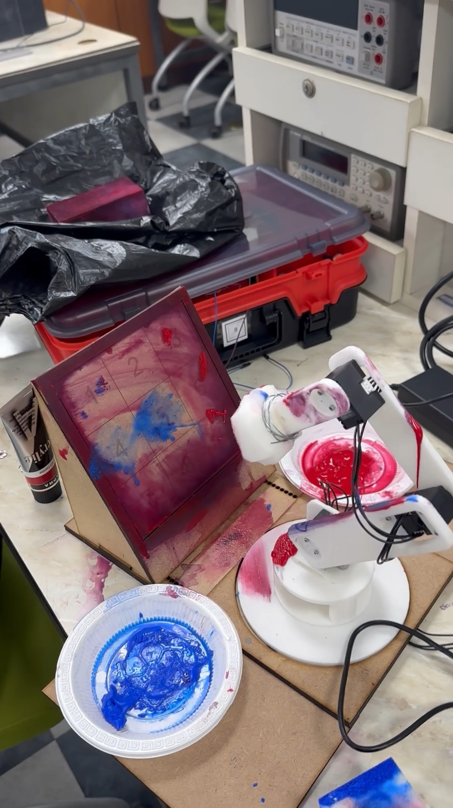
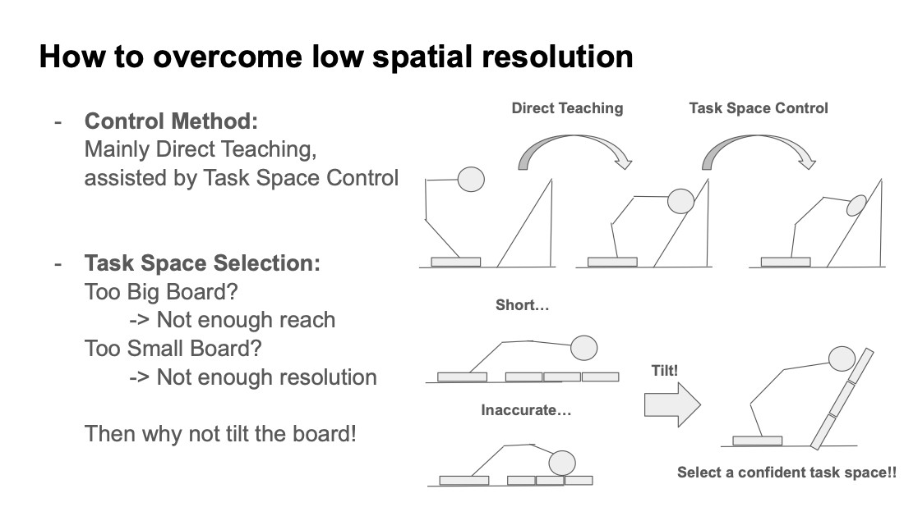
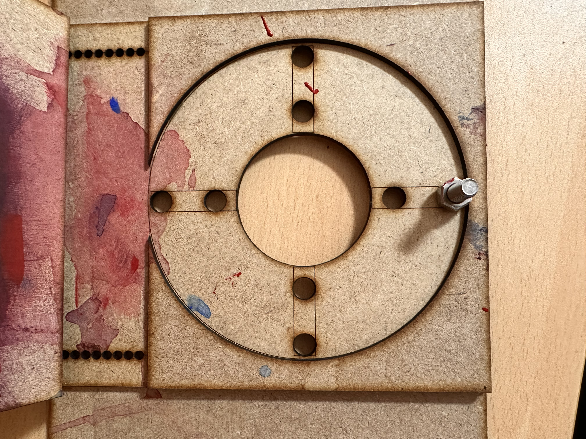

## A board game with a physical output

The task is to turn a discrete game decision into a repeatable physical action. A person chooses a cell in a terminal, the computer chooses its response, and a four-degree-of-freedom arm carries those moves onto a real 3×3 board. Separate red and blue paint stations identify the two players. The arm charges its end effector with paint, approaches the selected cell, makes a mark, and withdraws before the next turn.

This KAIST EE405 final project combines an interactive C++ application with calibration data, geometric robot models, actuator communication, and a deliberately chosen board arrangement. Input is through the keyboard: the game does not infer a player's move from a camera image.

<figure>

<figcaption>The final apparatus in a frame from the recorded demonstration: a tilted board in front of the arm and a paint station for each player.</figcaption>
</figure>

## Designing the board and end effector together

Board size creates a tradeoff. A larger board separates the cells more clearly but demands more reach. A smaller board fits the workspace more easily but makes neighboring cells harder to distinguish with limited positioning resolution. The project presentation motivates a tilted board as a way to place the task inside a more useful part of the arm's workspace.

The design uses a blunt stamping end effector rather than requiring the robot to trace an X or a circle. This reduces each move to approaching a location and making contact. The board support, stacked platform plates, circular base plate, and end-effector drawing connect that task definition to the mechanical arrangement. Direct teaching establishes usable poses on the actual apparatus, with task-space adjustment providing a further local motion.

<figure>

<figcaption>The project presentation connects the control method to the physical workspace: teach the main poses directly, then use task-space motion where useful.</figcaption>
</figure>

<figure>

<figcaption>A detail of the fabricated base plate. This detached mechanical part is distinct from the assembled robot shown above.</figcaption>
</figure>

## From a valid move to a complete motion sequence

The software separates responsibilities rather than placing every operation in one game loop.

| Layer | Responsibility |
| --- | --- |
| Board and game | Store occupied cells, validate input, select computer moves, and detect a win or draw |
| Robot player | Translate a player's identity and cell number into paint-station and board motions |
| Actuator interface | Read joint positions and send DYNAMIXEL velocity commands |
| Kinematics | Relate joint angles to end-effector position and calculate the translational Jacobian |
| Waypoint data | Keep calibrated board and paint-station joint configurations separate from game rules |

For a human turn, the program accepts a number from 1 to 9 and rejects an occupied cell, an out-of-range position, or invalid input. Once the move is accepted, the arm follows the same ordered sequence used for the computer: move above the appropriate paint station, lower to charge the end effector, lift away, move above the board, approach the selected cell, press, and retreat above the board.

Separating approach poses from marking poses makes the physical transition part of the application design. At the end of a round, the arm moves to a waiting pose while the user decides whether to restart and replace the paper. The software's board state is reset for a new game after that interaction.

## A small, explicit computer opponent

The opponent uses a three-stage rule. It first tests empty cells for an immediate computer win. If none wins, it tests for a move that blocks an immediate human win. Otherwise, it chooses randomly among the remaining empty cells.

Each hypothetical move is undone after the test so that searching for a response does not corrupt the live board. This is a rule-based opponent, not a trained model or a full minimax search. Its simplicity keeps attention on the harder integration problem: making a selected move correspond to the correct physical action.

## Teaching and organizing the coordinates

The waypoint-recording utility disables motor torque so that the arm can be positioned by hand. Keys 1–9 record the current four joint angles, and the finish command writes the collected configurations. These are joint-space targets measured on the setup rather than coordinates inferred from a visual board detector.

The game uses three datasets:

| Dataset | Shape | Purpose |
| --- | --- | --- |
| Human board targets | 9 × 4 | One four-joint configuration per cell for the human player's marking sequence |
| Computer board targets | 9 × 4 | The corresponding configurations for the computer player |
| Paint-station targets | 2 × 4 | One configuration for each player's paint station |

Recording poses and assigning them to these datasets are separate steps. The teaching utility produces one waypoint file; it does not automatically decide which measurements belong to a player or paint station. This distinction matters because a valid CSV shape does not establish that the coordinates match a changed board or robot arrangement.

## Interpolated joint motion and a Jacobian press

The main game configures four DYNAMIXEL axes in velocity mode with a requested control frequency of 100 Hz. A motion routine starts from the measured joint configuration and linearly interpolates toward the target over a chosen duration. Its nominal control law converts the error between the interpolated reference and current joint angles into velocity commands:

$$
\dot{q}_{\mathrm{cmd}} = K_p\bigl(q_{\mathrm{ref}}-q\bigr).
$$

The preserved Advanced implementation adds a small task-space displacement along the global/world −z axis after reaching a board waypoint. This axis is not automatically the tilted board's surface normal. It computes the world-frame translational Jacobian at the current configuration and forms a joint increment using a right pseudoinverse:

$$
\Delta q = J(q)^\mathsf{T}\bigl(J(q)J(q)^\mathsf{T}\bigr)^{-1}\Delta x,
\qquad \Delta x = [0,0,-0.01]^\mathsf{T}\ \mathrm{m}.
$$

The −10 mm value is the requested displacement in the code, not a measurement of achieved pressing depth or positioning accuracy. The operation is a kinematic adjustment, not contact-force feedback. It also relies on the local Jacobian and the invertibility of the matrix used in the calculation; it should not be read as a general collision or singularity-handling controller.

## Implementation variants and development context

Three preserved implementations help explain the engineering choices. Advanced combines the game with recorded joint targets and the additional Jacobian press. A separate task-space reference focuses on keyboard-directed arm motion and has no tic-tac-toe game layer. A tilt-compensation experiment attempts to account for a 60-degree rotation but retains an inconsistent variable name, so its presence is not evidence of a validated final controller.

The implementation uses C++17, Eigen3, CMake, Threads, and the DYNAMIXEL SDK, with the supplied default libraries targeting ARM Linux. Earlier labs establish the surrounding skills: GPIO and gripper switching, motor measurements and filtering, MATLAB plots, PC–BeagleBone TCP/UDP communication, direct teaching, and replay of saved joint targets. These exercises support the final integration without becoming separate claims about the final game's behavior.

## What the demonstration establishes

The final-apparatus recording documents console interaction and the robot's approach, pressing, and retreat motions at the physical board. A separate short recording shows a person demonstrating sponge stamping and the game interface; that manual action should be distinguished from automatic robot motion.

Together, the footage, drawings, and implementation show how the project connects game logic to physical marking. They do not establish a measured success rate, repeatability bound, a complete autonomous game, or an exact match between the filmed executable and one preserved source variant. The central engineering result is the integration of a familiar discrete task with calibration, workspace design, and robot control.
