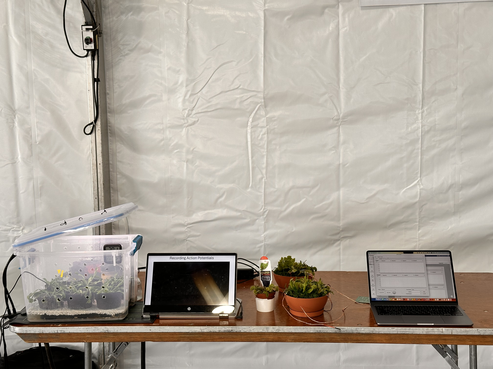
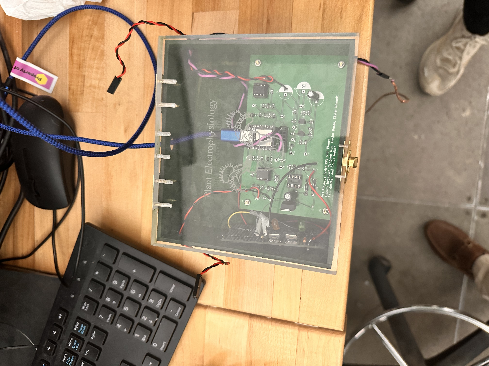
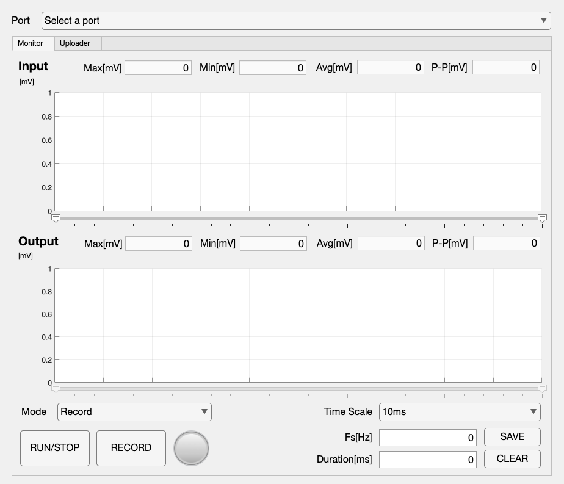

## 식물의 전기적 반응을 기록하고 재생하기

파리지옥은 자극을 받으면 전기적 신호가 발생하고, 이어서 포충엽이 빠르게 닫힙니다. 이 학제 간 캡스톤 프로젝트는 닫힘 동작과 관련된 신호를 기록한 뒤 이를 재현해 전기적으로 닫힘을 유도할 수 있는지 탐구했습니다.

팀은 전기 신호를 기록하는 과정과 파형을 재생해 포충엽의 닫힘을 유도하는 과정을 모두 시연했습니다.

<figure>

<figcaption>Senior Design 발표 현장의 식물, 관찰 영상과 제어 앱입니다. 팀은 신호 기록과 전기 자극에 따른 닫힘을 시연했습니다.</figcaption>
</figure>

## 최종 시스템

**Seeeduino**를 **USB/직렬 통신**으로 노트북에 직접 연결했습니다. C++ 펌웨어는 신호 수집과 파형 출력을 담당했고, **MATLAB App Designer** 애플리케이션은 모니터링, 시각화, 기록, 파형 전송, 재생 제어를 지원했습니다. 별도의 MATLAB 스크립트로 신호 분석과 디지털 시스템 검증을 수행했습니다.

식물 신호 수집, 노트북에서의 기록·시각화, 임베디드 장치를 통한 전기적 재생을 하나의 시스템으로 연결했습니다.

<figure>

<figcaption>아날로그 신호 조절 회로와 디지털 제어부를 조립한 팀의 실물 장치입니다. 저는 펌웨어와 노트북 앱을 포함한 디지털 시스템을 담당했습니다.</figcaption>
</figure>

## 기록에서 재생으로 이어지는 앱

Hashirama 앱은 입력·출력 파형을 모니터링하고, 기록한 신호를 CSV로 저장하며, 선택 구간을 재생 파형으로 장치에 전송하는 작업 흐름을 제공했습니다. 한 화면에서 장치 연결, 모니터링, 기록과 재생 준비를 다룰 수 있도록 구성했습니다.

<figure>

<figcaption>MATLAB App Designer로 만든 Hashirama의 Monitor 화면. 연결 전의 빈 초기 화면으로, 측정 결과 파형을 나타내는 이미지는 아닙니다.</figcaption>
</figure>

## 담당한 부분

Seeeduino 펌웨어, MATLAB 소프트웨어와 인터페이스, 장치 통신, 기록·재생 과정을 포함한 전체 디지털 하위 시스템을 설계하고 프로그래밍했습니다. 생물학적 실험과 아날로그 하드웨어는 팀 전체의 작업에 해당합니다.
