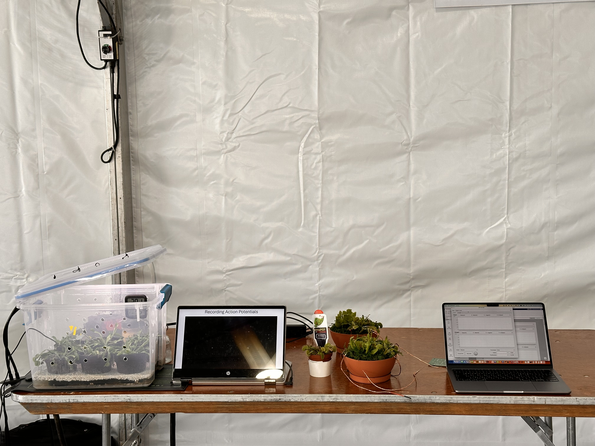
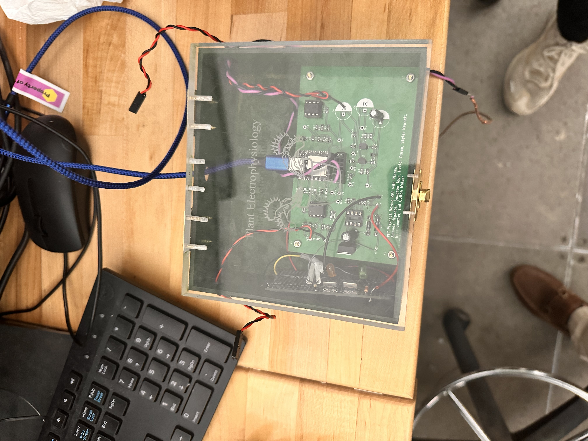
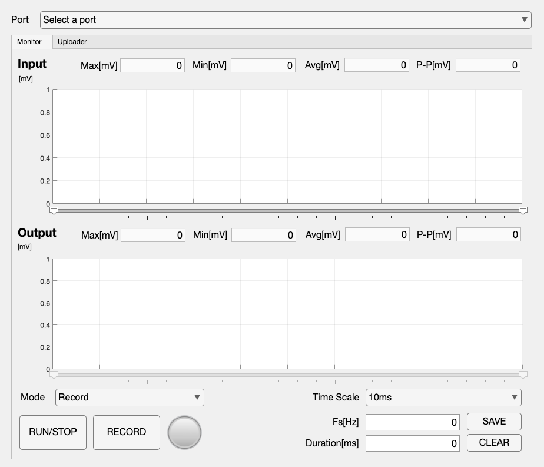

## Recording and replaying a plant's electrical response

The Venus flytrap responds to stimulation through electrical signaling that precedes its rapid closing motion. This interdisciplinary capstone explored whether a signal associated with closure could be recorded and then reproduced to induce closure electrically.

The team demonstrated both parts of that workflow: recording the electrical signal and triggering trap closure through waveform playback.

<figure>

<figcaption>The Senior Design setup brought together the plants, observation footage, and control application for the team's recording and stimulation demonstration.</figcaption>
</figure>

## Final system

A **Seeeduino** connected directly to a laptop over **USB/serial**. C++ firmware handled signal acquisition and waveform output, while a **MATLAB App Designer** application supported monitoring, visualization, recording, waveform transfer, and playback control. Supporting MATLAB scripts enabled signal analysis and digital-system verification.

The workflow connected plant-signal acquisition, laptop recording and visualization, and embedded electrical playback into one system.

<figure>

<figcaption>The team's assembled device contains analog signal conditioning and digital control. My responsibility was the digital system, including firmware and the laptop application.</figcaption>
</figure>

## An application from recording to playback

The Hashirama application supported input/output monitoring, recording and CSV storage, interval selection, and waveform upload to the device. Its workflow brought device connection, monitoring, recording, and playback preparation into one interface.

<figure>

<figcaption>The Hashirama Monitor interface built with MATLAB App Designer. This is its empty initial view before connection, rather than a recorded experimental waveform.</figcaption>
</figure>

## My contribution

I designed and programmed the complete digital subsystem, including the Seeeduino firmware, MATLAB software and interface, device communication, and recording/playback workflow. The biological experimentation and analog hardware were parts of the team effort.
