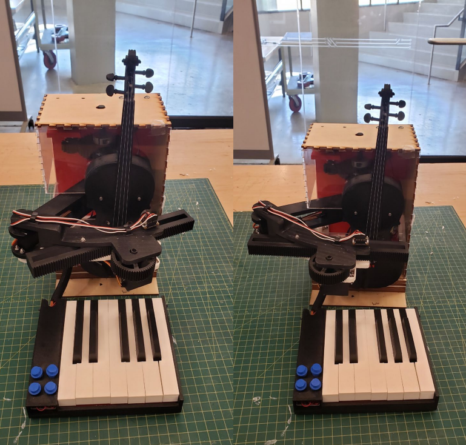
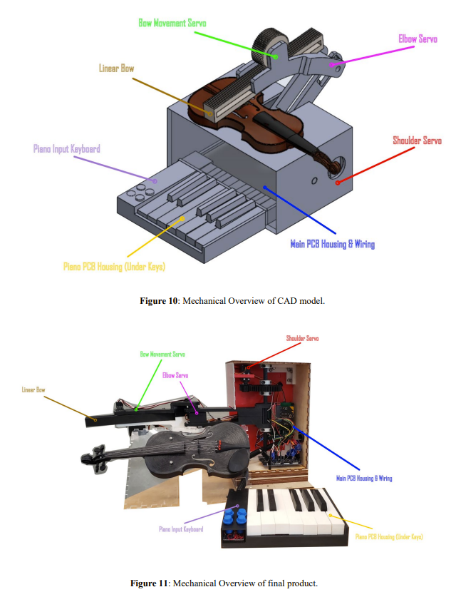
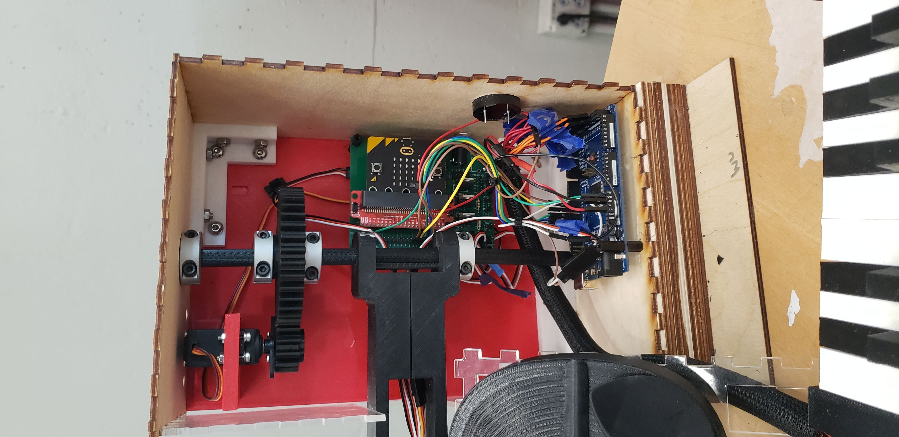
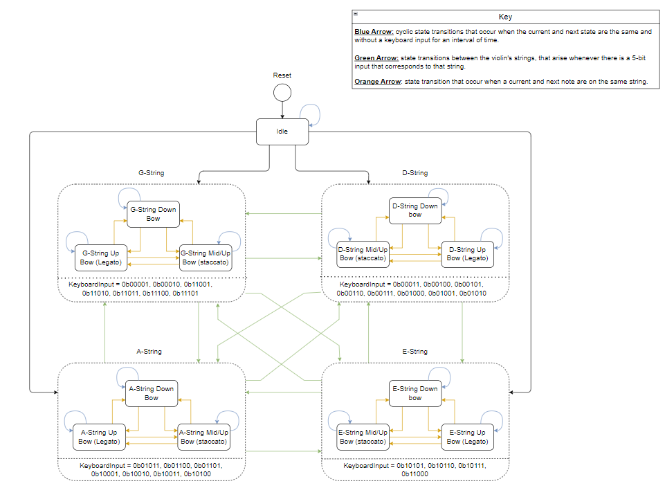

## A physical connection between music and code

RoBACHtic Symphony was developed by a four-person team for Georgia Tech's ECE 3011 — Design Fundamentals course in Fall 2023. We explored an educational kit for fifth-grade STEAM activities: a student selects a note on a piano-style keyboard, hears its pitch, and watches a model arm move to the corresponding violin string.

The teaching idea was to make a musical instruction visible as a physical action. The project therefore combined a custom keyboard, embedded control, a scaled violin model, servo-driven mechanisms, and a lesson plan. I led the mechanical design and fabrication, working from SolidWorks models through part production and repeated integration revisions.

<figure>

<figcaption>The completed prototype brings the keyboard, violin model, geared arm, and laser-cut enclosure into one demonstration system.</figcaption>
</figure>

## System architecture: one input, two coordinated outputs

The central interaction connects keyboard input to both movement and sound. The controller interprets a note together with the selected octave, chooses the corresponding string position, and coordinates the arm with electronic note output from the micro:bit speaker.

| Subsystem | Function in the project |
| --- | --- |
| Piano-style keyboard | Provides twelve note keys and additional controls, including octave selection. |
| Input and control electronics | Connects the keyboard with the controller and translates input into note and motion states. |
| Robotic arm | Selects the string position and demonstrates basic bow movement. |
| Electronic audio | Produces note frequencies through the micro:bit speaker in the demonstrated prototype. |
| Mechanical frame | Supports the violin model, arm, keyboard, and electronics while leaving room for motion and wiring. |

Key + octave<b aria-hidden="true">→</b>Note / string state<b aria-hidden="true">→</b>Arm position + tone

The team deliberately simplified the motion of a human arm into a mechanism that could be built and understood as an educational model. This made part geometry, joint motion, and the correspondence between a musical note and a string target central design questions.

## Mechanical design and fabrication

The mechanism had three main actuation functions. The shoulder selected the arm's position across the strings. The elbow adjusted the bow's relationship to the violin. The bow drive produced the basic up/down stroke. Gear mechanisms and the supporting frame connected those motions to the model instrument.

My work covered the mechanical parts and their SolidWorks models, fabrication of the components, laser-cut wooden panels, and changes prompted by testing and subsystem integration. The design included arm and bow components, gears and shafts, the keyboard housing and keys, and the main enclosure. The source project retains CAD, printable parts, and laser-cut panel geometry for these assemblies.

A major iteration concerned the space swept by the arm. Early movement models used simple mock-ups and laser-cut acrylic/wooden components to isolate the desired motion. These checks showed that the bow arm needed clearance from the enclosure throughout its travel. A part could fit at rest and still collide when the mechanism moved, so enclosure dimensions and arm geometry had to be considered together.

The keyboard also required mechanical and electrical coordination. Printed keys and button extenders had to line up with the switches beneath them, while the housing had to support repeatable key movement. Within the main box, component positions had to accommodate the control boards, mounting hardware, gears, and wiring.

<figure>

<figcaption>The CAD-to-build comparison locates the main actuation functions, bow, keyboard, and electronics housings.</figcaption>
</figure>

<figure>

<figcaption>The internal arrangement shows the close connection between mechanical clearances, mounting positions, and electrical integration.</figcaption>
</figure>

## Keyboard input and state-based control

A note and an octave jointly determine the controller's musical state. That state must provide two related outputs: a pitch for the audio system and a target position for the arm. Different notes can belong to the same violin string, so a new pitch does not always require a change of string position.

The design separated input handling, state transitions, audio, and arm movement. The state-machine diagrams organize the mechanism around idle and the four violin-string groups, with transitions driven by keyboard input. Within each string group, the design also considered different bow directions and articulation modes.

<figure>

<figcaption>The design-stage state machine relates keyboard input to string and bow states. Its staccato and legato branches describe planned behavior; those articulation controls were incomplete in the final demonstration.</figcaption>
</figure>

The implementation work progressed through smaller interface tests. A pull-up button program checked the basic pressed/released logic on the micro:bit. An Arduino Mega keyboard test read individual key switches and encoded the selected note into a four-bit value. The micro:bit development code reconstructed a note identifier from digital inputs and included routines for moving the shoulder and elbow toward configured string targets in incremental steps.

These development programs explain how the team tested the interfaces before bringing the system together. They include intermediate and test-specific behavior; the final demonstration's scope is described below. The project used the keyboard as a musical interface, without establishing a general-purpose MIDI protocol implementation.

## Electronics and subsystem integration

The electrical design separated the keyboard PCB from the main controller board. The keyboard design collected the note and control switches; the main board provided interfaces for the micro:bit, servos, indicators, and supporting circuitry. The design also explored GPIO expansion, an IMU, regulated power, and an external amplifier/speaker path.

Integration involved more than connecting the finished boards. The team first breadboarded the keyboard and main circuit sections, checked the PCB design with electrical-rule checks, and used a multimeter to check connectivity after soldering. Serial output from the micro:bit and Arduino Mega helped distinguish an input-reading problem from a state-selection or output-motion problem.

Mechanical checks were equally specific. The team verified that printed and laser-cut parts fit the electrical components, and used Allen keys as placeholders to check frame-hole alignment before final mounting. Servo motion was adjusted through incremental position commands and timing changes so that the arm could reach the intended string positions.

## Demonstration and reported observations

The final presentation exercised all twelve piano keys in two octave ranges. Each key produced a distinct electronic note, the octave buttons changed the available range, and the arm moved to the string position associated with the selected note. The prototype also demonstrated basic up/down bow movement and the connection between the keyboard PCB and the electronics in the main enclosure.

The final report records several useful observations about the physical prototype:

| Item | Reported observation |
| --- | --- |
| Prototype mass | 6 kg |
| Dimensions in the powered configuration | 45 × 51 × 38 cm |
| Transition between strings | 3–7 seconds, compared with a design target below 0.5 seconds |

The transition time made an important constraint visible: the mechanism could show a string change, but its motion was substantially slower than the original responsiveness target. These are the team's reported prototype observations in the [final design document](https://github.com/BellLabsEra/RoBACHtic-Symphony/blob/main/ECE3011%20Team%20C2%20Final%20Document%20Package.pdf).

Several features remained partial. Staccato and legato controls were unfinished, only two of the four string-indicator LEDs worked reliably in the reported integration, and the external class-D amplifier/speaker path was not successfully configured. The intended IMU feedback was also incomplete, and sound duration did not track the duration of a key press. The demonstrated audio therefore used the micro:bit's electronic tones, while the arm supplied the visible physical demonstration.

## Lesson plan and proposed classroom workflow

The team prepared a lesson plan alongside the design document, bill of materials, and project notebook. It targeted Georgia's fifth-grade Music and Computer Science Standards of Excellence, connecting digital sound, sequencing, musical notation, and the visible motion of the robot.

The proposed sequence was:

1. **Introduce the violin and its strings.** Connect open-string notes and bow movement to familiar instrumental music.
2. **Discuss basic music theory.** Introduce the octave and bow-direction/articulation notation.
3. **Explain digital sound.** Compare analog and digital representations and introduce the kit as a simple electronic sound generator.
4. **Assemble and identify the system.** Relate the keyboard, controller, and moving components to their functions.
5. **Practice and debug.** Use a simple melody such as “Twinkle, Twinkle, Little Star” to connect the selected notes with the model's behavior.
6. **Compose and review.** Write a short 10–20-note melody using at least three different notes and five bow-notation uses, then exchange feedback with a peer.

The lesson plan also treated the machine's constraints as a design activity: students could adapt a piece to its transition time and single-string behavior, combine it with traditional instruments, or consider multiple units. These were proposed classroom activities. The project produced the prototype and teaching materials; classroom learning outcomes were not measured.

## Engineering takeaways

The project connected a musical interaction with the practical limits of a moving mechanism. Clearances, mounting geometry, and the time needed to reposition the arm directly affected what the interface could demonstrate. Small button and serial tests made subsystem integration more tractable, while the final presentation distinguished the working note/string interaction from the broader feature set imagined during design.

My contribution was the mechanical path through that process: translating the concept into SolidWorks parts, fabricating the assembly, and revising it as the electrical and control subsystems came together. The completed result was a team-built educational demonstrator supported by design, fabrication, test, and lesson-plan documentation.
