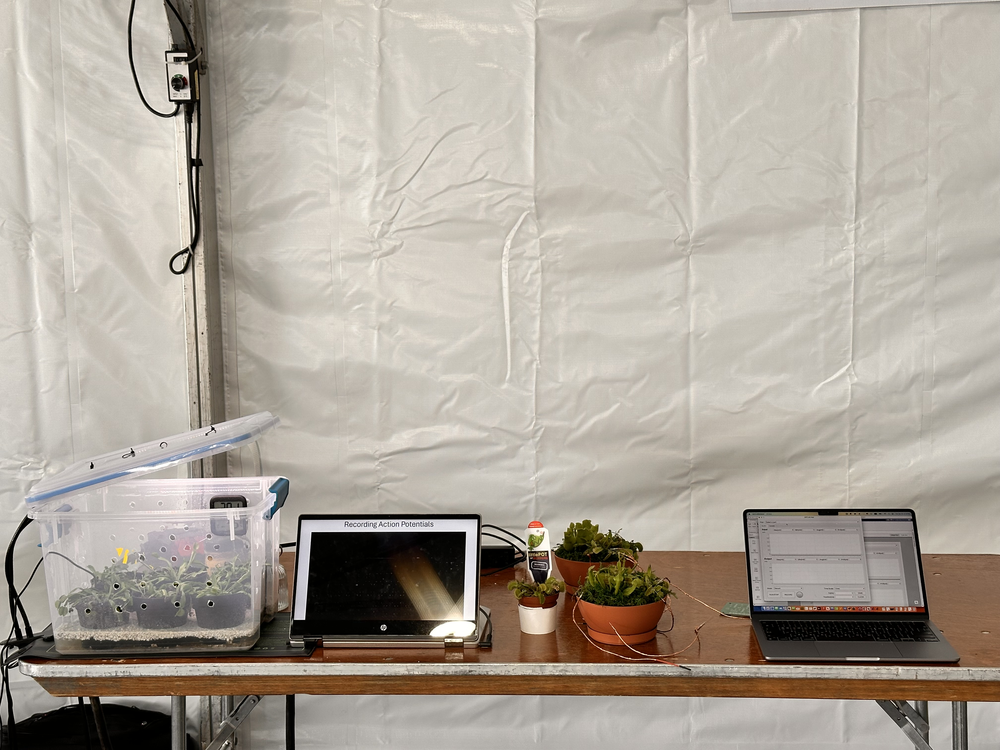
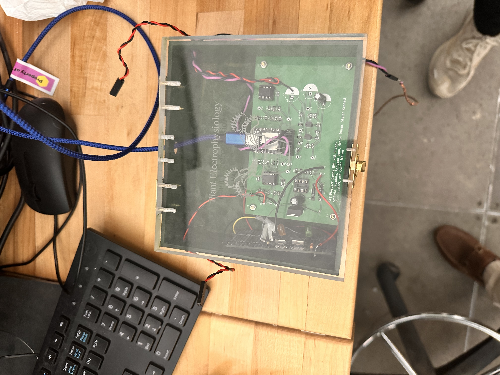
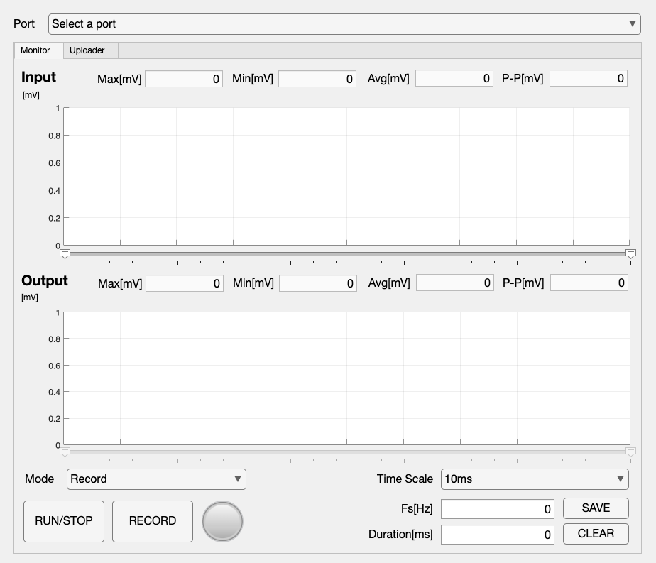
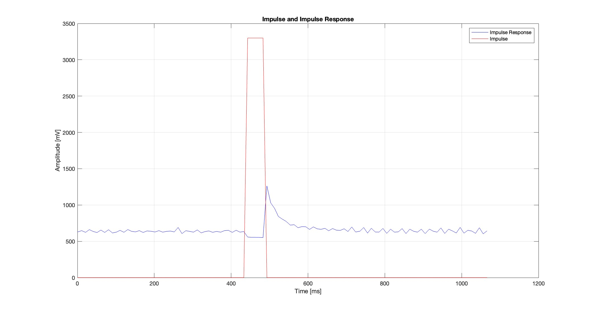

## 생체전기 반응을 기록한 뒤 전기적으로 재현하기

파리지옥은 식물 전기생리학을 눈에 보이는 동작과 연결해 살펴볼 수 있는 대상입니다. 자극에 따른 전기적 활동과 함께 포충엽이 빠르게 닫힙니다. 2024년 봄학기의 Senior Design 프로젝트에서는 닫힘과 관련된 신호를 수집하고, 재사용할 수 있는 기록으로 보관한 뒤, 파형을 식물에 다시 인가해 닫힘을 유도할 수 있는지 탐구했습니다.

완성한 실험 장치는 전극과 아날로그 신호 조절 회로, Seeeduino XIAO, USB로 연결한 노트북, **Hashirama**라는 MATLAB 앱을 결합합니다. 팀은 신호 기록과 장치의 전기 자극에 따른 포충엽 닫힘을 모두 시연했습니다. 위의 설명 영상은 시스템 전체를, 본문 아래의 짧은 영상들은 실제 닫힘과 파형 업로드 과정을 보여 줍니다.

프로젝트 지도교수는 **Dr. William Hunt**였으며, **Vivent Biosignals**와 연계해 진행했습니다. 식물 전기생리학을 응용 배경으로 삼아 신호 기록과 전기 자극에 대한 관찰 가능한 반응을 연결했습니다.

<figure>



<figcaption>Senior Design 발표 현장에서는 식물, 관찰 영상, 조립한 실험 장치와 노트북 인터페이스를 함께 보여 주었습니다.</figcaption>
</figure>

## 식물에서 노트북으로, 다시 식물로

신호 기록과 전기 자극에는 서로 다른 입출력 인터페이스가 필요합니다. 입력부에서는 전극의 작은 신호를 증폭·필터링하고 DC 오프셋을 더한 뒤 마이크로컨트롤러의 ADC로 보냅니다. 오프셋은 조절된 파형을 장치가 읽을 수 있는 범위에 놓기 위한 것입니다. 출력부에서는 DAC 신호를 감쇠하고 오프셋을 제거한 뒤 자극 전극으로 전달합니다.

| 구성 | 최종 시제품에서의 역할 |
| --- | --- |
| 식물 전극과 입력 신호 조절 회로 | 실험 대상을 증폭·필터링·바이어스한 전기적 입력으로 연결 |
| Seeeduino XIAO | 조절된 입력의 디지털 변환, 업로드한 파형의 버퍼링, 재생 신호 출력 |
| USB/직렬 통신과 Hashirama | 노트북으로 자료 전송, 시각화·저장, 재생할 구간의 선택과 준비 |
| 출력 신호 조절 회로와 전극 | DAC 출력을 식물 자극 실험에 맞게 조절 |

이에 따라 신호를 수집하고, 확인·저장하고, 필요한 구간을 고르고, 장치에 전송하고, 전기적으로 재생하면서 반응을 관찰하는 하나의 흐름을 만들었습니다. MATLAB은 노트북에서 직접 실행했습니다.

<figure>



<figcaption>팀의 아날로그 신호 조절 회로와 디지털 제어부를 함께 조립한 장치입니다. 저는 전체 디지털 하위 시스템을 설계하고 프로그래밍했습니다.</figcaption>
</figure>

## 임베디드 신호 수집과 파형 출력

펌웨어 **Senju**는 Arduino 스타일의 C++로 구현했습니다. 최종 설정에서는 **A1**을 12비트 ADC 입력으로, **A0**를 10비트 DAC 재생 출력으로 사용합니다. 소프트웨어는 3300 mV의 장치 기준 전압을 사용해 변환기 코드와 전압 값을 연결합니다. 이 값은 아날로그 신호 조절을 거친 장치 인터페이스의 전압입니다.

제어부는 대기, 업로드, 모니터링 상태를 구분합니다. 상태 표시 핀으로 동작을 알리고, 원형 버퍼에 노트북에서 받은 파형을 보관합니다. 모니터링 중에는 ADC 입력을 읽고, 재생 버퍼에서 출력 샘플을 선택하고, DAC를 갱신한 뒤, 시각이 붙은 입력·출력 자료를 노트북에 보냅니다. 별도의 명령으로 유한한 펄스를 출력하고 그에 대한 반응을 수집합니다.

물리적 입출력 가까이에서 신호 수집과 출력을 수행하고, 시각화·기록 관리·구간 선택은 노트북에서 처리하도록 역할을 나눴습니다. 버퍼도 장치 상태의 일부이므로, 노트북에서 파일을 고르는 것과 그 샘플을 제어부에 실제로 업로드하는 것은 서로 다른 작업입니다.

## 펌웨어와 MATLAB 사이의 작은 프로토콜

두 프로그램은 **9600 baud**로 통신합니다. MATLAB은 16비트 명령과 파형 샘플을 보내고, 펌웨어는 낮은 바이트를 먼저 받은 뒤 높은 바이트와 합쳐 값을 복원합니다. 제어 명령은 10비트 파형 코드의 예정된 범위와 겹치지 않는 값으로 구분합니다.

| 명령 | 기능 |
| --- | --- |
| `SIG_IDLE` / `0x4944` | 대기 상태로 전환 |
| `SIG_UPLOAD` / `0x554C` | 재생 버퍼로 파형 수신 |
| `SIG_MONITOR` / `0x4D4E` | 입력 신호 수집과 재생 출력 수행 |
| `SIG_IMPULSE` / `0x4950` | 유한한 펄스를 출력하고 반응 수집 |
| `SIG_FLUSH` / `0x464C` | 기존 재생 파형 삭제 |

장치가 노트북으로 보내는 방향에서는 다음 ASCII 형식을 사용합니다.

```text
timestamp_ms,input_mV,output_mV;
```

세미콜론은 레코드를, 쉼표는 세 값을 구분합니다. 저장한 CSV에는 `Time`과 `Volt_In`, `Volt_Out` 중 하나 또는 둘 다 들어갑니다. 시간의 단위는 밀리초, 전압의 단위는 신호 조절을 거친 장치 인터페이스에서의 밀리볼트입니다. 따라서 저장된 전압을 식물 전극의 원래 전압으로 곧바로 읽어서는 안 됩니다.

## Hashirama에서 확인·기록·선택·전송하기

MATLAB App Designer 앱은 두 주요 화면으로 동작을 연결합니다. **Monitor**는 입력과 출력을 함께 보여 주고, **Uploader**는 기록한 자료를 재생할 파형으로 준비합니다. 관찰한 사건을 재사용 가능한 자극 파형으로 바꾸는 과정에서 여러 도구 사이로 자료를 수동 이동하지 않도록 구성했습니다.

| Monitor 모드 | 작업 흐름 |
| --- | --- |
| `Record` | 입력 신호를 관찰하고 기록 |
| `Playback` | 제어부에 업로드한 파형 재생 |
| `Record & Playback` | 같은 실험에서 입력과 출력을 함께 관찰 |
| `Impulse Response` | 유한한 펄스를 인가하고 수집한 반응 확인 |

Monitor에는 시간 축 조절, 구간 선택 커서와 신호 요약값을 넣었습니다. 보이는 플롯과 별도로 기록을 시작·중지하고, 전체 기록이나 선택 구간을 CSV로 저장할 수 있습니다. 긴 관찰 시간과 그 안에서 분석·재생에 사용할 짧은 사건 구간을 구분하기 위한 기능입니다.

<figure>



<figcaption>최종 Hashirama의 Monitor 인터페이스입니다. 이 이미지는 연결 전의 빈 초기 화면이며, 측정한 실험 파형이 아닙니다.</figcaption>
</figure>

기록한 신호를 다시 재생하는 대표적인 작업 순서는 다음과 같습니다.

1. 장치를 USB로 연결하고 Hashirama를 실행한 뒤 직렬 포트를 선택합니다.
2. Monitor 모드를 고르고 **RUN/STOP**으로 수집 또는 출력을 제어합니다.
3. 사건을 기록해 CSV로 저장하거나 플롯에서 필요한 구간을 선택해 저장합니다.
4. Uploader에서 CSV를 불러오고 전체 파형 또는 일부 범위를 고릅니다.
5. 준비한 샘플을 업로드하고 Monitor로 돌아와 Playback 또는 Record & Playback을 실행합니다.

준비 과정에서 앱은 가져온 자료의 시간 원점을 맞추고 중복 타임스탬프를 제거한 뒤, 선택한 파형을 명목상 2 ms 간격의 격자에서 spline 보간합니다. 이후 밀리볼트 값을 출력 코드로 바꿔 전송합니다. 이 격자는 재생 자료를 준비하는 기준이며, 시스템 전체가 실제로 달성한 샘플링 속도를 그 자체로 입증하지는 않습니다.

## 측정 자료와 검증

보존된 자료에는 원본 CSV 기록, 펄스·반응 그래프, 오실로스코프 캡처와 **10 Hz부터 100 Hz까지**의 사인파 검증 자료 열 세트가 있습니다. 각 주파수의 두 오실로스코프 이미지는 저장된 서로 다른 화면이며, 반복성 연구나 주파수별 성공률을 뜻하지 않습니다.

벤치 검증과 식물 시연은 다른 질문을 다룹니다. 전자는 장치를 통과한 신호와 소프트웨어에 표시되는 자료를 확인하고, 후자는 조립한 시스템으로 전기 자극을 가했을 때 생물학적 반응이 나타나는지 보여 줍니다. 둘 중 하나를 다른 검증의 대체물로 해석하지 않았습니다.

<figure>



<figcaption>프로젝트에 보존된 원본 펄스·반응 그래프입니다. 축은 시간과 신호 조절을 거친 장치 인터페이스 전압을 나타내며, 아날로그 인터페이스의 효과가 포함돼 있습니다.</figcaption>
</figure>

원본 보관함의 두 닫힘 영상 중 하나를 이 페이지에 실었습니다. 해당 시연에서 팀이 전기적으로 닫힘을 유도했다는 근거이며, 수치로 된 성공률이나 반응 지연 분포, 자극 전략 사이의 통제된 비교를 제시하는 자료는 아닙니다.

## 시제품의 경계와 설계에서 배운 점

보존된 소프트웨어를 보면 다음에 개선할 부분도 구체적입니다. 앱이 허용하는 업로드 샘플 수가 펌웨어의 10,000샘플 재생 버퍼보다 큽니다. 모니터링 루프에는 지연과 직렬 출력이 포함되므로, 명목상 2 ms 인덱싱 간격을 보장된 500 Hz 수집 속도로 해석할 수 없습니다. 임펄스 반응을 내보내는 경로도 더 작은 반응 버퍼에 맞춰 전송 길이를 정리해야 재사용할 수 있습니다.

이를 발전시키려면 두 프로그램의 업로드 한도를 일치시키고, 버퍼에 실제로 들어 있는 파형의 길이를 추적하며, 읽기 경계에서 끊긴 직렬 레코드를 다음 읽기까지 보관해야 합니다. 샘플의 시간 기준을 통신·화면 갱신 작업과 분리하는 것도 중요합니다. 동작하는 시연과 반복적으로 사용할 수 있는 계측 플랫폼 사이에는 타이밍, 상태 관리, 자료 무결성이라는 설계 과제가 있습니다.

최종 App Designer 파일에는 앱 코드와 콜백이 들어 있습니다. 이전 MATLAB 스크립트와 RTOS 실험은 개발 이력이며 앱을 실행하는 데 필요한 구성은 아닙니다. 보존된 소스로 장치를 다시 구동하려면 대응하는 보드 툴체인, 원형 버퍼 라이브러리, 아날로그 회로와 전극이 필요합니다.

## 담당 역할과 프로젝트 자료

저는 **전체 디지털 시스템**을 설계하고 프로그래밍했습니다. Seeeduino 펌웨어, MATLAB 앱과 인터페이스, 직렬 통신, 신호 수집·모니터링, 파형 준비, 기록·재생 흐름을 담당했습니다. 팀은 아날로그 하드웨어와 생물학적 실험을 이 디지털 하위 시스템과 통합했습니다.

[프로젝트 저장소](https://github.com/EonSJeon/Gatech-ECE4723-PROJ)에는 최종 앱과 펌웨어, 구현 노트, 측정 자료, 원본 미디어와 개발 이력이 보존돼 있습니다. [최종 포스터](https://github.com/EonSJeon/Gatech-ECE4723-PROJ/blob/main/docs/poster/venus-flytrap-recording-playback-poster.jpeg)는 연구 동기, 회로도, 소프트웨어 설계와 당시 검증 내용을 한눈에 모아 보여 줍니다.
