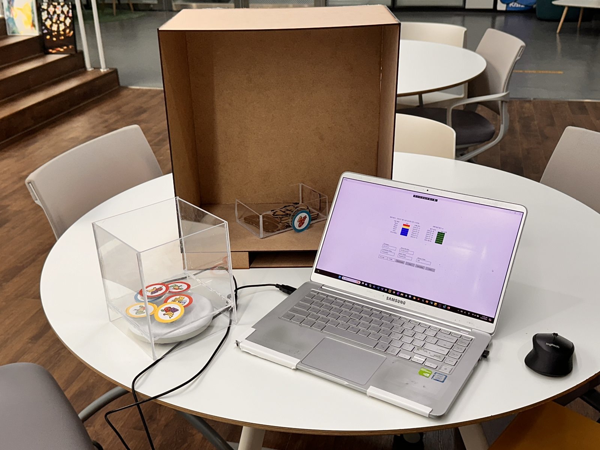
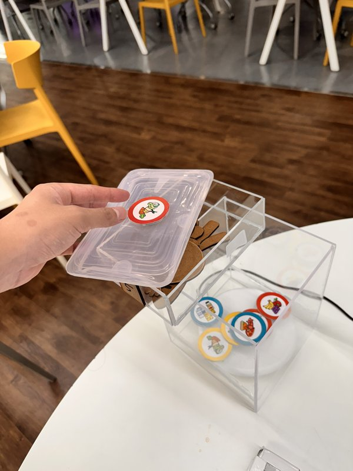
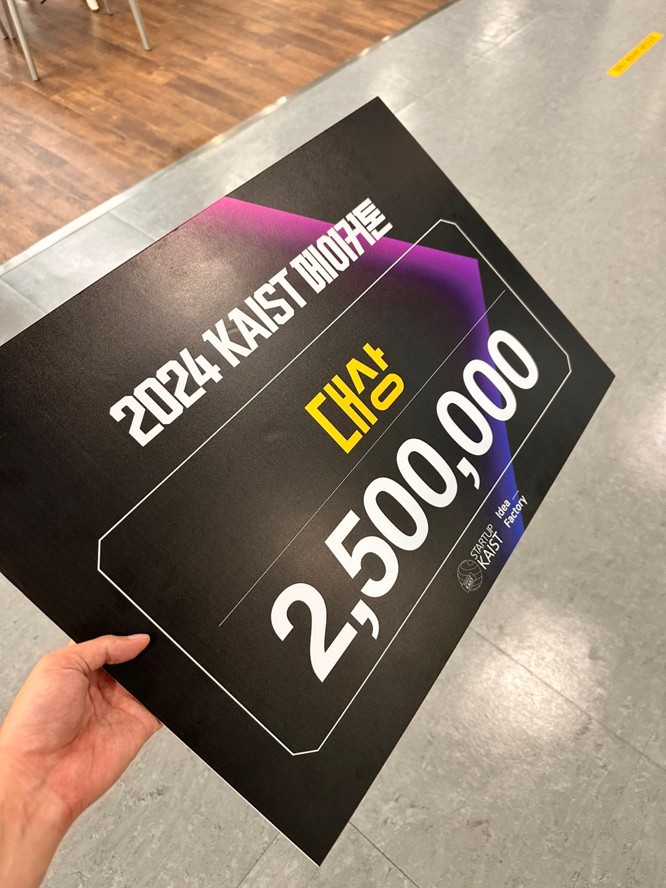

## 일상적인 식품 보관을 위한 물리적 알림

냉장고에 보관한 식품을 관리하는 일은 쉽지 않습니다. 인쇄된 라벨이 작거나 읽기 어려우면 더욱 그렇습니다. <strong>When to Eat(웬 투 잇)</strong>은 식품 용기에 연결하는 재사용 RFID 토큰, 토큰 보관 스테이션, 보관 시간을 보여주는 데스크톱 화면을 결합한 인터페이스입니다.

스테이션에서 토큰을 꺼내면 사용 기간 추적이 시작되고, 다시 돌려놓으면 추적 상태가 초기화됩니다. 화면에는 식품 분류, 날짜, 남은 일수가 표시되며, 권장 폐기일이 가까워지거나 지난 식품은 시각적으로 구분합니다.

<figure>

<figcaption>발표 당시의 시제품 구성입니다. 용기에 붙이는 토큰과 리더가 있는 보관함을 Windows 화면에 연결했습니다.</figcaption>
</figure>

## 용기에 붙이고, 보관함으로 돌려놓기

식품 그림이 있는 토큰은 용기의 뚜껑이나 옆면에 붙일 수 있습니다. 사용하지 않는 토큰을 보관함에 모아 두고, 리더가 더 이상 감지하지 못하는 토큰에 해당하는 식품을 사용 중인 목록에 표시하는 방식입니다.

<figure>

<figcaption>식품 용기의 뚜껑에 부착한 재사용 토큰. 사용을 마친 뒤 보관함에 돌려놓는 물리적 동작을 추적 상태와 연결했습니다.</figcaption>
</figure>

## 구현

팀은 제조사의 .NET SDK와 USB 가상 COM 포트를 통해 **ATID ATD100 UHF RFID 리더**를 연동했습니다. **C#과 XAML**로 작성한 Windows UWP 애플리케이션은 태그 인식 이벤트를 받아 보관 시간 화면을 갱신합니다. 용기 형태에 맞는 토큰 부착 방식도 검토했습니다.

시연은 예제 토큰과 미리 정한 보관 기간을 사용했습니다. 이 시제품은 보관 경과 시간을 추적하고 참고 기준에 따른 알림을 표시합니다. 식품의 부패를 직접 측정하거나 섭취 안전성을 판정하는 장치는 아닙니다.

## 결과

**2024 KAIST Makerathon**에서 <strong>대상(1위)</strong>과 상금 **250만 원**을 받았습니다. 전상언은 4인 팀의 팀장을 맡았습니다.

<figure>

<figcaption>2024 KAIST Makerathon 대상 상패. 팀은 대상과 상금 250만 원을 받았습니다.</figcaption>
</figure>
