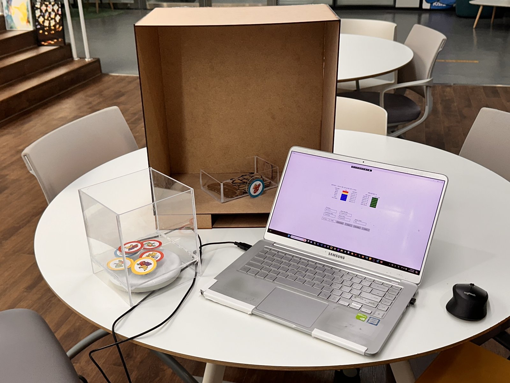
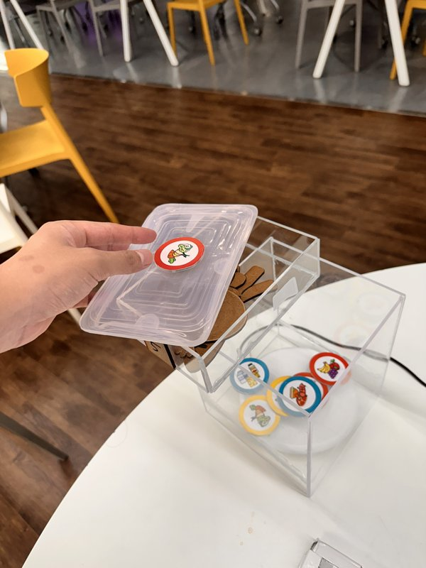
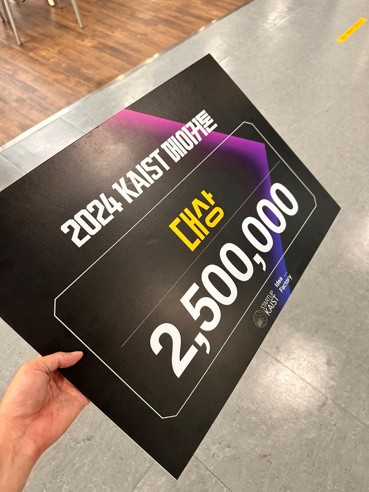

## A physical reminder for everyday food storage

Keeping track of food in a refrigerator can be difficult, particularly when printed labels are small or hard to read. **When to Eat (웬 투 잇)** explores a more tangible interface: reusable RFID tokens associated with food containers, a token storage station, and a desktop display of storage time.

Removing a token from the station starts tracking its period of use. Returning it resets the tracking state. The interface shows food categories, dates, and remaining days, with visual indicators for approaching or passed suggested discard dates.

<figure>

<figcaption>The demonstrated setup connected reusable container tokens and a reader-equipped storage station to a Windows interface.</figcaption>
</figure>

## Attach, use, and return

Illustrated tokens can attach to a container's lid or side. Unused tokens sit in the storage station; a token that is no longer detected by its reader places the associated food on the active list. Returning the token connects a familiar physical action to resetting its tracking state.

<figure>

<figcaption>A reusable token attached to a container lid. Moving tokens between containers and the station provides the physical input to the reminder.</figcaption>
</figure>

## Implementation

The team integrated an **ATID ATD100 UHF RFID reader** through the manufacturer's .NET SDK and a USB virtual COM port. A Windows UWP application, written in **C# and XAML**, receives tag-read events and updates the time-based storage display. The team also explored token attachments suited to different container shapes.

The demonstration used example tokens and preset storage periods. The prototype tracks elapsed storage time and displays reference-based reminders. It does not directly measure spoilage or determine whether food is safe to eat.

## Outcome

The project received the **Grand Prize (first place)** at the **2024 KAIST Makerathon**, with a **₩2,500,000** prize. Sangeon Jeon served as team leader of the four-person team.

<figure>

<figcaption>The team's Grand Prize award at the 2024 KAIST Makerathon, with a ₩2,500,000 prize.</figcaption>
</figure>
