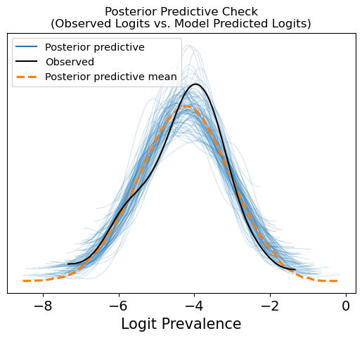

## 서로 다른 유병률 정의를 함께 다루기

강박장애(Obsessive-Compulsive Disorder, OCD) 연구는 특정 시점, 최근 1년, 평생의 유병률처럼 서로 다른 추정 대상을 다룹니다. 진단 기준, 참여자의 연령과 조사 지역도 연구마다 다릅니다. 이 프로젝트는 이러한 차이를 하나의 통계 분석 안에 반영하는 방법을 다룹니다.

연구 간 차이를 표현하면서도 유병 기간과 대상 인구가 명확한 요약을 만드는 것이 핵심 질문입니다. 여기서 다루는 질환 OCD는 통신 연구에서 사용하는 OCDM 파형과 별개의 주제입니다.

## 계층적 분석과 모델 진단

모형에는 유병 기간, 진단 기준, 광범위한 연령군과 국가·지역·상위 지역의 지리적 계층을 반영합니다. Python/Jupyter 분석에서 PyMC로 Bayesian 추정을 수행하고 ArviZ로 진단 결과를 요약하며, 국가·지역·전 세계 단위의 결과표를 생성하는 흐름을 구성합니다.

<figure>

<figcaption>한 분석 실행에서 관측된 연구별 logit 분포와 모형이 생성한 분포를 비교한 사후예측 점검입니다. 모형의 동작을 살펴보는 진단이며, 인구 수준 추정치의 타당성을 확정하는 결과는 아닙니다.</figcaption>
</figure>

## 해석 범위

자료를 종합할 때는 각 관측값의 수치뿐 아니라 무엇을 측정했는지도 함께 고려해야 합니다. 같은 코호트의 반복 관측, 진단 기준, 연령 구성의 차이는 종합된 자료에서 추론할 수 있는 범위에 영향을 줍니다.

인구 수준의 해석은 지리 코드, 가중 방식, 직접 관측이 적은 지역의 불확실성 처리에도 의존합니다. 위 그림은 모델 평가의 한 요소입니다. 이 소개에서는 연구 질문과 계산 접근을 중심으로 설명하며, 수치로 된 유병률·국가 순위나 독립적으로 검증된 인구 추정 성능을 제시하지 않습니다.
