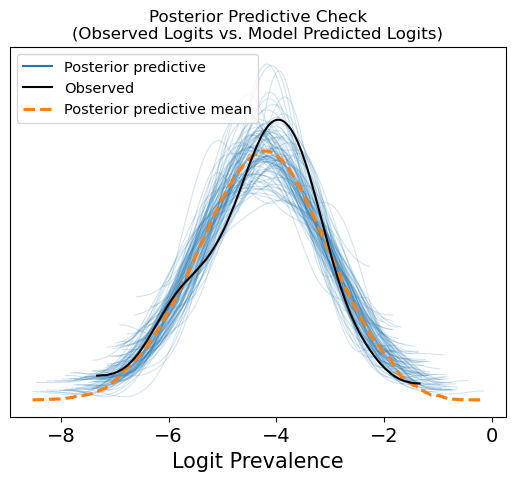

## Reconciling prevalence definitions

Studies of obsessive-compulsive disorder (OCD) can describe different quantities: prevalence at a particular point, over a year, or across a lifetime. They also differ in diagnostic definitions, participant ages, and geographic coverage. This project examines how to bring those distinctions into a common statistical analysis.

The research question is how a synthesis can represent differences between studies while producing summaries with a clearly defined prevalence period and population. The disorder studied here is OCD, separate from the OCDM waveform used in my communications research.

## Hierarchical analysis and diagnostics

The model represents prevalence period, diagnostic definitions, broad age groups, and a geographic hierarchy of countries, regions, and super-regions. A Python/Jupyter workflow uses PyMC for Bayesian estimation and ArviZ for diagnostic summaries, with country, regional, and global result-table generation.

<figure>

<figcaption>A posterior predictive check comparing observed study logits with replicated distributions from an analysis run. This diagnostic examines model behavior; it does not establish the validity of population-level estimates.</figcaption>
</figure>

## Interpretation

A synthesis must account for the meaning of each observation as well as its numerical value. Repeated observations from a cohort, diagnostic definitions, and differences in age composition affect what can be inferred from the combined evidence.

Population-level interpretation also depends on geographic coding, weighting, and uncertainty for locations with little direct evidence. The diagnostic above is one component of model assessment. The project is presented through its research question and computational approach, without numerical prevalence estimates, country rankings, or claims of independently validated population inference.
